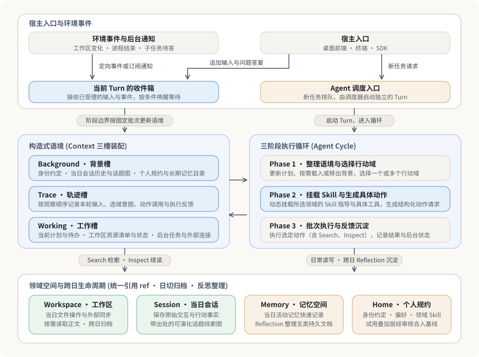
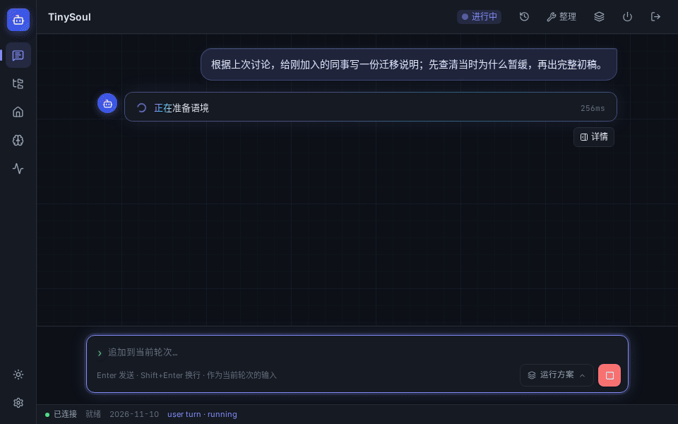
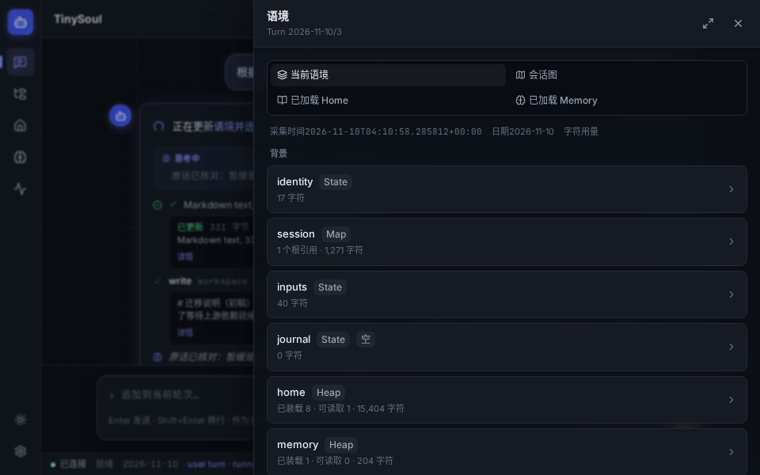
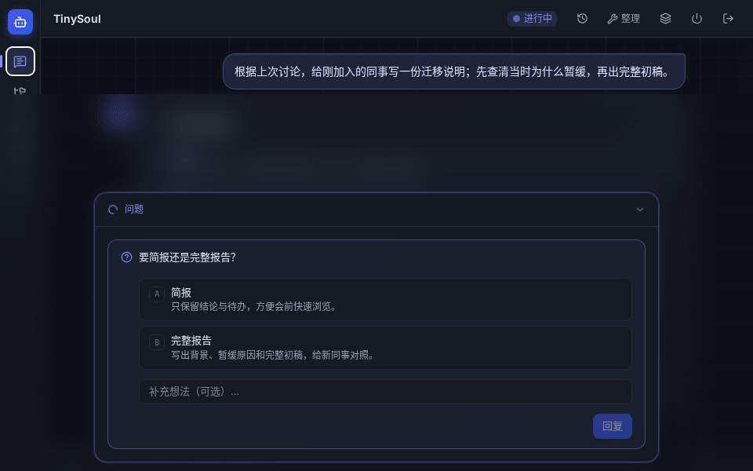
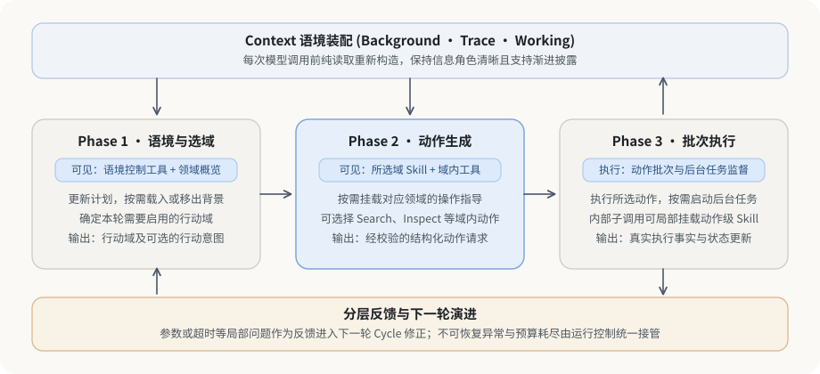
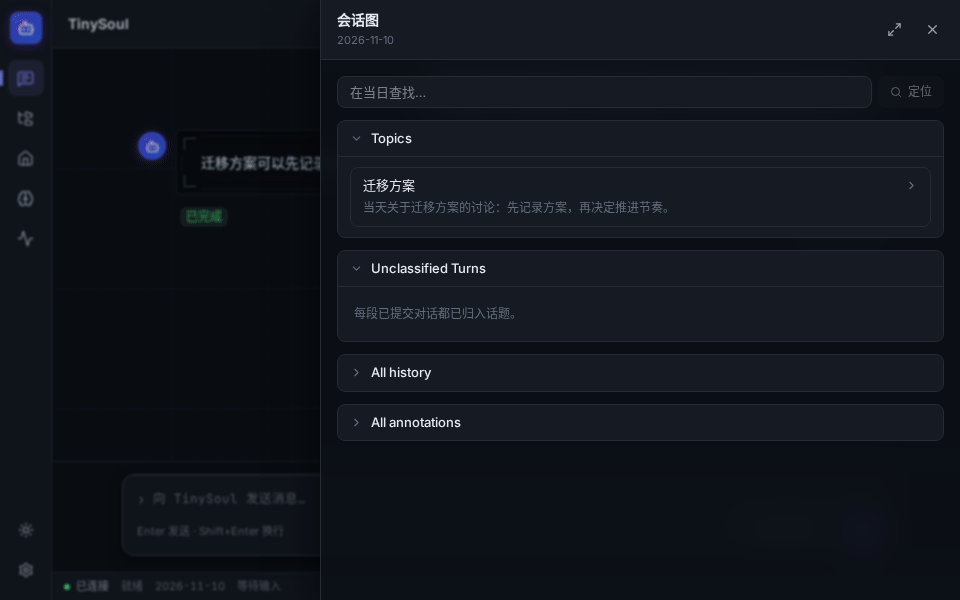
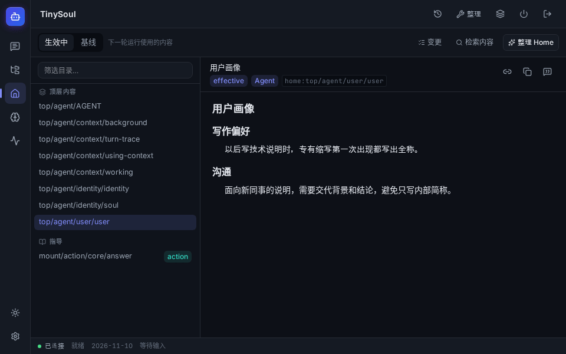

# TinySoul-Agent · 面向持续协作的个人 Agent

简体中文 · [English](docs/intro/README.en.md) · **[启动指南](docs/intro/getting-started.zh-CN.md)** · [Getting started](docs/intro/getting-started.en.md)

TinySoul 是我在空闲时间通过 vibe coding 持续探索和打磨的个人 Agent 项目。初衷很朴素：把一件事情交给它之后，依然可以半途改主意、补材料；合上电脑离开一会儿，或者过几天再回来，也能看懂工作怎样一步步走到这里，接着往下做。

我所关心的持续协作跨越两个时间尺度。眼前的执行要跟得上变化：用户补充的要求、外部修改的文件、刚跑完的后台脚本，都可能改变下一步判断。跨天的工作则要分清事实与经验：哪些事情确实发生过，哪些只是阶段性判断，哪些有效做法可以沉淀成日后沿用的习惯。

围绕这些目标，TinySoul 用语境（Context）组织模型眼前的信息，用行动（Actions）和工作区（Workspace）推进任务。会话（Session）保存交互经过，记忆（Memory）积累有来源的知识，个人规约（Home）保存偏好与做事方法。后端管理这些内容的生命周期，用户通过桌面前端、终端或 Python SDK 参与工作。

> **安全说明**：这是仍在开发和验证中的个人项目。Agent 可以执行命令、修改文件、调用外部服务，可能误操作、泄露提供给它的数据或产生 API 费用。请在隔离的虚拟机、专用测试机等环境中尝试，只提供可丢弃或已备份的数据；不要直接用于工作电脑或生产环境，也不要提供重要凭据。远程访问请使用受信网络，并保管好登录 token。

安装与运行指令集中在[中文启动指南](docs/intro/getting-started.zh-CN.md)和[英文启动指南](docs/intro/getting-started.en.md)，涵盖 uv 开发/标准安装、模型配置、需要 Rust 的桌面前端，以及独立主机连接。下文介绍项目的设计思路。

## 一次决策怎样发生

在决策步 $t$，Agent 从环境状态 $s_t$ 获得观测 $o_t$，并按当前目标 $g_t$ 从记忆 $M_t$ 取回材料 $r_t$。相对稳定的背景 $b_t$、此前的本轮轨迹 $h_t$ 和新信息共同构成语境 $c_t$，策略 $\pi$ 据此选择行动 $a_t$：

$$
\begin{aligned}
o_t &= O(s_t), & r_t &= R(M_t,g_t,o_t), \\
c_t &= C(g_t,b_t,h_t,o_t,r_t), & a_t &\sim \pi(\cdot\mid c_t).
\end{aligned}
$$

不需要检索时，$r_t=\varnothing$。两次决策之间，用户、外部服务和后台任务也会改变环境。这个表述借鉴了 Hu 等人对观测、行动与记忆的描述（[Memory in the Age of AI Agents，第 2 节](https://arxiv.org/html/2512.13564v2#S2)）。TinySoul 将语境构造 $C$ 单独列出：同样的材料，以怎样的结构、顺序和粒度进入模型，会影响接下来的判断。

## 核心架构一览

| 关注的问题 | TinySoul 的设计 |
| --- | --- |
| 背景、历史过程与资源现态如何区分 | **三槽 Context**：Background、Trace、Working 分工，每次模型调用前重新组装输入。 |
| 能力增多后如何选择工具 | **三阶段 Cycle**：先选行动域，再挂载局部 Skill、生成动作，最后执行并反馈。 |
| 如何找到材料并真正读到它 | **统一引用、Search 与 Inspect**：检索线索、分页读取；新读到的完整页面经过主循环模型响应后才允许折叠。 |
| 多话题交错时如何回看 | **单日历史与话题图谱**：保留交互事实，单独维护有出处的解释与澄清。 |
| 临时要求如何成为长期经验 | **Memory、Home 与 Reflection**：日常记录和试用，独立整理后写入持久知识与正式规约。 |
| 如何组织运行和模块协作 | **统一调度与分层失败处理**：局部反馈、模块错误和运行转移各有职责，模块通过明确边界协作。 |

## 1. 模型任务与模型链

长任务里的不同环节，对模型的要求并不相同。选择行动需要理解目标和工具条件，撰写答复需要组织证据，检索排序可能只需要向量相似度或相关性打分。TinySoul 按**任务用途**决定带入哪些语境、开放哪些工具，以及怎样解释结果。主循环决策与内容生成可以分别配置候选模型链，辅助判断与向量检索通过专门的模型服务配置。

模型可以在途中更换，已发生的工作仍要接得上。TinySoul 将模型的**行动意图**和系统的**执行事实**分开记录。接手的模型能分清一次操作是已成功、失败、尚未执行，还是仍由后台任务监督，进而决定等待、检查产物或继续下一步。

适配层将内部记录转换为 OpenAI Chat Completions、OpenAI Responses、Anthropic Messages 和 Google GenerateContent 四类接口所需的形式。调用条件兼容时，可以回放供应商专有的推理状态，并按接口能力使用稳定前缀缓存；跨服务切换时，去掉不兼容的状态，保留输入、行动请求和已知结果的工作顺序。

## 2. Context 的组合与插件式构造

用户偏好可能长期有效，草稿状态却可能在两次调用之间从“待写”变为“待审”。**Context 让模型看清每条信息在当前工作中起什么作用。** 一个活动 Turn 的语境分为三个槽位：

1. **Background（背景）**：身份约定、当日已完成的会话与话题线索、当前轮用户输入，以及 Home、Memory 的目录和已载入内容。
2. **Trace（轨迹）**：按运行系统观察到的顺序，记录本轮输入、选域判断、行动调用与执行反馈。
3. **Working（当前状态）**：计划的里程碑和待办、工作区文件入口与说明，以及任务和连接状态。

例如，草稿写入成功后，Trace 留下调用与结果，Working 中的工作区视图呈现新文件入口。Agent 可以把“审阅草稿”列入待办，再沿入口读取正文。

这些语境片段由各自模块维护，每次模型调用前纯读取、按顺序组装。Workspace 提供文件引用与说明，正文通过读取动作进入 Trace；执行模块报告进程状态与输出位置。接入新能力时，也要安排好模型何时看见它的状态、怎样读取详情。

## 3. Search、Inspect 与按需载入

如果只记得某项设计曾因维护成本被搁置，可以用 **Search** 找到讨论，再沿引用用 **Inspect** 核对原话；知道资料位置时，直接 Inspect 即可。会话、记忆、Home 与工作区共用引用约定，内容仍由所属模块管理。

Search 由三种候选来源（`query`、`backlinks`、`directory`）和三种约束操作（`select`、`rerank`、`filter`）组成有限管道。模型选择操作与业务参数，文本匹配、向量计算或模型打分由配置绑定。结果带回命中片段、覆盖范围和引用，便于判断什么值得细读。

Inspect 分页呈现正文，说明实际读取范围，并提供续页入口。语境紧张时，较早的读取可以折叠为带说明的引用；再次读取可变文件时，取得的是当前内容。刚读到的完整页面则受到保护：只有它进入过一次**取得响应的主循环模型请求**后，才允许按容量折叠。动作内部的辅助模型调用不会提前解除保护。

## 4. Agent SDK 与环境事件

模型判断期间，用户还在追加要求，文件可能被修改，后台进程也可能结束。终端、前端与宿主程序通过同一个 Agent 入口提交请求、追加信息或回答问题。文件监听器提供线索，Workspace 同步真实磁盘状态后，再通知当前任务。

运行期间收到的信息先进入当前 Turn 的收件箱，在阶段边界按固定批次合入 Context。回看某一步决定时，便能知道模型当时已经收到哪些信息。事件是否唤醒等待，取决于正在等待的内容；普通文件刷新可以合并，后台任务完成则可以唤醒相应等待。

人的输入也分两类：Agent 问“要简报还是完整报告”时，“完整报告”是关联原问题和选项的正式回复；“先等我补一份材料”则是追加指示。分别记录，才能看清用户决定了什么、什么仍未回答。

## 5. Agent Loop、Skill 与执行反馈

一次用户请求形成一个 **Turn**，其中可以经历多个执行轮（**Cycle**）。每个 Cycle 分为三个阶段：

1. **Phase 1：整理语境与选择行动域。** 模型看到控制工具和能力域概览，更新计划、载入或移出背景，并选择本轮需要的行动域。
2. **Phase 2：挂载 Skill 与生成动作。** 只开放所选域内的 Action Tools，附上对应领域的操作指导，生成具体 ActionCall。
3. **Phase 3：批次执行与反馈。** 执行动作，必要时启动可跨 Cycle 的 Job，将结果与状态反馈给当前 Turn。Job 随所属 Turn 收尾。

行动域限定需要考虑的工具，Skill 提供使用方法。若动作内部还要调用模型，更具体的指导随那次调用局部载入。[ReAct](https://arxiv.org/abs/2210.03629) 描述了推理与行动的交替协作；TinySoul 进一步明确选域、局部指导和执行反馈的交接。代价是正常循环多一次串行选域调用，这是面向复杂长任务的质量、延迟与成本取舍。

轨迹中可以分别查看选了什么方向、提出什么动作、实际得到什么结果。可修正的参数或协议问题、单次行动失败，形成局部反馈交给后续 Cycle；Phase 协议失败会结束当前 Cycle。配置无法解释、模型链耗尽等无法继续的问题由模块边界交给 Runtime 处理。预算耗尽时可以暂停，等待用户补额或中断。

## 6. Session 的线性历史与话题线索

一天里会交错讨论多个话题，同一轮讨论也可能关联不同主题。TinySoul 以 Turn 为单位保存已完成的用户交互，将同一活动日的 User Turn 组成一个 **Session**。话题线索帮助找到相关讨论，不重复保存交互正文。

Session 将原始记录与事后理解分开。底层保留输入、关键行动与结果，先后顺序、回复和引用关系由事实确定；上层维护有出处的话题与说明。例如，最初将“暂缓迁移”理解为“方案放弃”，后来用户澄清是在等上游依赖。Agent 可以修订解释，同时连回两次发言，保留原决定与澄清的来路。

长任务跨过午夜时，先在原活动日完成必要收尾，再归档该日的 Session、活动记忆、Workspace 与 Trash，开启新日。Home 与持久 Memory 跨日保留。日切不依赖 Reflection 成功，当时的事实仍有固定出处。

## 7. Memory、Home 与 Reflection

“这次说明会的读者是新成员”是有场合和来源的事实，适合记入 **Memory**；“以后写技术说明，缩写首次出现时写出全称”是未来做事的偏好，适合进入 **Home**。

两者都采用日常记录或试用、独立反思整理的设计。普通 Turn 可以修改活动记忆；每日策略或用户明确授权安排 **Memory Reflection** 后，再结合来源交互与已有知识，整理为 daily、entity、concept、fact、note 五类持久文档。引用连接证据，也派生可查询的反向链接；内容迁移可通过说明与重定向保留去向。

Home 的日常修改先进入跨日保留的试用层，由 **Home Reflection** 对照已接受的基线审核，再决定合入、改写或放弃。两类 Reflection 都复用相同的 Turn/Cycle/Phase 内核，通过专门情景取得资料和受约束的权限；它们不写入用户 Session，也不会把单次授权变成持续许可。

整理质量仍在验证中，尤其需要分清一次交付的临时要求与愿意长期沿用的个人偏好。

## 8. MCP、ACP 与能力扩展

外部工具调用通常等待一次结果，委派一项工作则可能需要跨多轮检查进展、回应权限问题和审阅交付。TinySoul 分别通过 **MCP**（Model Context Protocol）和 **ACP**（Agent Client Protocol）接入这些能力，集成仍在持续验证。

MCP 先按需发现工具并读取定义，再调用；简短结果进入语境，大块材料可存入工作区继续读取。ACP 委派带着目标和选定材料，作为受监督的 Job 跨 Cycle 执行；父 Agent 检查进度、处理待答并审阅产物。后台工作始终属于当前 Turn。

浏览器与桌面操作仍在规划中：设想外层 Loop 给出局部目标，内层处理页面观察、操作和结果检查，再返回相关材料与出处。这些尚未作为现有能力提供。

## 9. 主机部署与远程使用

核心执行、Session、Memory 与 Workspace 放在持续运行的个人主机上，电脑上的前端负责输入、查看和控制。通过主机地址和稳定 token 连接，本地与远程使用同一种登录流程；界面支持亮暗主题和中英文切换。

前端断开后，仍在运行的后端可以继续处理任务，或等待用户回复。重连时，前端查询当前任务和待答，接续可获得的观察事件；错过的事件超出缓冲范围时，重新读取当前状态。

这种连续性以**后端进程持续运行**为前提。已保存的历史和文件可以跨次启动使用，尚未完成的 Turn 不支持进程崩溃后续跑。具体启动与连接步骤见[启动指南](docs/intro/getting-started.zh-CN.md)。

## 继续阅读

- [架构与模块设计](docs/design/) · [Agent SDK 与生命周期](docs/design/agent.md)
- [Endpoint 协议](docs/endpoint/index.md) · [前端设计](visualization/docs/design/index.md)
- [测试说明](tests/README.md) · [项目协作规约](AGENTS.md)
