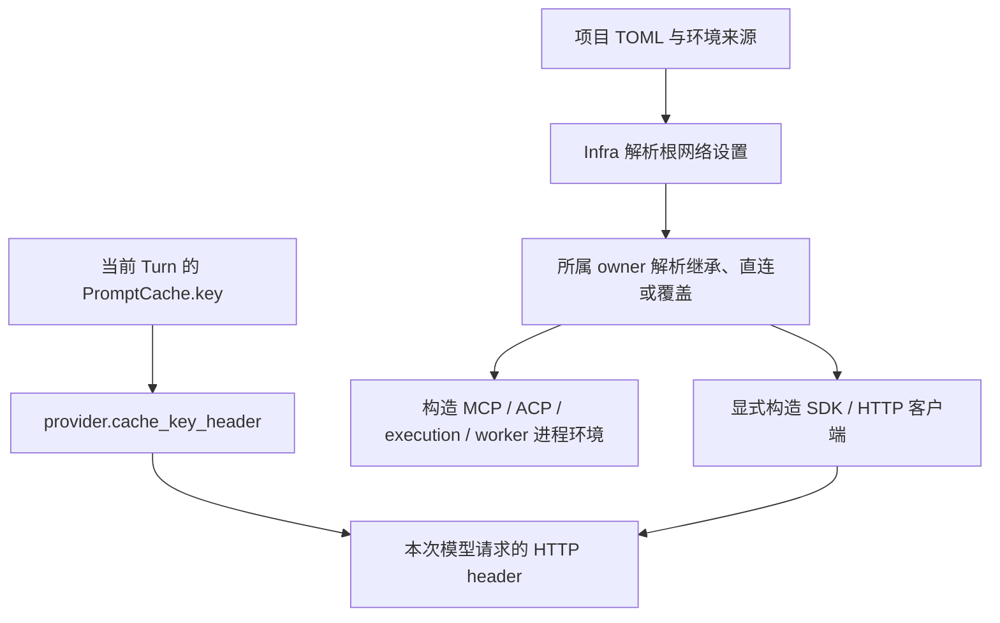

# OpenCode Go 接入与统一网络配置执行计划

日期：2026-10-23。

状态：`in_progress`。本轮实现已完成主要代码、配置、文档和前端接入；真实 OpenCode 的 DeepSeek 缓存仍受上游 503 阻塞，因此按规约保留本计划，未归档为 done。

依据：重新阅读根目录 `AGENTS.md`，对照 `docs/design/infra.md`、`llm.md`、`execution.md`、各 capability 设计，以及当前配置、装配、SDK、worker 和进程调用路径。

本次交付范围：OpenCode Go 接入、统一出站网络配置、请求身份和配置编辑链路。真实测试使用隔离项目，未修改运行项目的凭据或启用默认 provider。

## 1. 目标与已确认方向

1. 接入 OpenCode Go provider，复用四类 API mode 的现有通用/专用 adapter；provider 不成为第五类 API mode，也不新增无专属模型语义的 OpenCode adapter。
2. Infra 统一解释 HTTP/HTTPS 代理与 no_proxy，装配时显式传给 SDK/HTTP 客户端及进程 owner。
3. LLM、Embedding/决策模型、MCP、ACP、Web 和 execution 可以继承统一设置、明确直连或使用自己的覆盖配置。
4. TinySoul 自己发起的模型及 HTTP 请求使用公共 User-Agent。身份属于 HTTP 连接层，不进入模型消息或任务提示。
5. OpenCode 的 `x-opencode-session` 以当前 Turn 已有 `PromptCache.key` 为值，保持同一 Turn 主调用、辅助调用和重试的路由一致性。
6. 配置经现有 TOML → owner parser → Endpoint 配置投影/草稿 → apply/reload 链路生效。客户端和连接继续由现有 generation、plugin 或短请求 owner 释放。
7. 正常路径优先；不新增代理健康检查、代理自动切换、故障后静默直连、系统代理修改、会话数据库、任意 header 模板引擎或第二套重试流程。
8. 不保留历史兼容别名。已有专用模型 provider 的单字段 `proxy` 改用统一 `network` 结构，代码、模板、文档和测试一并更新。

## 2. 当前实现与已有验证

| 范围 | 当前实现 | 本轮需要补齐的实际缺口 |
| --- | --- | --- |
| 配置来源 | `ConfigEnvironment` 合并 TOML、dotenv、进程环境与显式覆盖；不修改 `os.environ` | dotenv 中常规代理变量不会自动进入 SDK 的环境读取或 execution 子进程 |
| Infra | `InfraSettings` 目前只承载 model_services | 增加统一网络策略、解析与连接设施 |
| LLM | `adapter/factory.py` 创建 OpenAI/Anthropic SDK；Google 有独立 `GoogleClient` | 客户端没有项目级代理注入，模型请求没有公共 TinySoul User-Agent |
| 模型能力查询 | `adapter/anthropic/models.py` 独立创建短生命周期 SDK client | 也必须使用选中 provider/endpoint 的网络设置，不能只改生成调用 |
| 专用模型 | `infra/model_services/service.py` 使用 HTTPX；`ServiceProvider.proxy` 单独生效 | 移除平行的代理配置语义，接入共享策略 |
| MCP | Streamable HTTP 自建 `httpx2.AsyncClient`；stdio 使用 `StdioProcess` | 两种 transport 都要消费相同的 server 网络策略 |
| ACP | target 环境引用经 owner 解析后传给 `StdioProcess` | target 可配置网络策略，并避免继承的代理变量覆盖“直连” |
| Web | 主服务以受控 worker 执行；抓取 client 显式 `trust_env=False`；Kimi Search 在 worker 内另建同步 OpenAI client | 仅传环境变量不足以让抓取走代理；两条网络调用路径都要显式装配 |
| execution | `ExecutionEngine` 启动 Python/bash/PowerShell/cmd，主要继承宿主环境 | 接收项目网络设置，支持 interpreter 覆盖，保留现有进程监督 |
| 请求头 | provider/endpoint 已有 `headers`、`header_refs`；Web 已有局部 TinySoul User-Agent 默认值 | 复用静态头机制；增加一个有限的动态 key 映射，抽取公共身份 |
| 缓存路由 | Context 以 Turn ID 构造 `PromptCache.key`；TaskCall → ProviderRequest 已传递 | 无需再建 session_id；只补 provider header 消费者 |

上一轮的真实探测使用仓库 `.env` 的 `OPENCODE_API_KEY`，没有写入密钥或修改运行项目：

- 四类 Go 路径的最小 HTTP 请求均返回过 200。
- 通过现有 TinySoul adapter，GPT Luna、Claude Haiku、Gemini Argon，以及使用通用 Responses 的 Grok 完成简单代码生成。
- DeepSeek 的现有模型配置调用连续返回 503，远端摘要为 `Upstream request failed: Endpoint is unavailable.`。最小请求曾成功，不能据此断言全部参数正确，也不能断言 TinySoul 映射错误；正式验收仍须复测。
- 进程未设置常规代理环境变量；`127.0.0.1:7897` 可连接，直连和通过该代理读取 OpenCode models 均成功。这不是代理已接入项目的证据。
- 上述探测只证明基本连通和部分请求映射，不替代图片、JSON、工具、回放和缓存验收；Grok 诊断脚本中的临时上下文值不作为模型规格依据。

## 3. 统一代理配置语义

### 3.1 一种策略结构，三种明确模式

所有位置复用同一 `NetworkPolicy`（frozen dataclass），模式使用 `StrEnum`：

| mode | 含义 | 地址字段 |
| --- | --- | --- |
| `inherit` | 使用直接上级已经解析的网络配置 | 不填写 http_proxy/https_proxy/no_proxy |
| `direct` | TinySoul 管理的 HTTP 客户端明确不使用代理；子进程清除代理环境提示 | 不填写地址字段 |
| `override` | 使用此处声明的完整代理配置 | 显式填写所需协议地址及可选 no_proxy |

字段统一使用 `mode`、`http_proxy`、`https_proxy`、`no_proxy`。不保留 `proxy`、`proxy_url`、`use_proxy` 等平行表达。

- 缺少整个 `network` 配置时等价于 `mode="inherit"`。
- `override` 是完整覆盖，不逐字段悄悄借用上级值：缺少或为空的协议地址表示该协议直连。至少提供一个非空代理地址；全部直连使用 `direct`。
- `no_proxy` 使用逗号分隔文本。override 未填写时默认 `localhost,127.0.0.1,::1`；显式空字符串表示没有绕过项。
- http_proxy/https_proxy 根据目标 URL 的协议选择；访问 HTTPS 时，代理 URL 仍可以是 `http://127.0.0.1:7897`。
- 本轮正式支持 HTTP/HTTPS 代理地址，以及域名、域名后缀、IP、可选端口和 `*` 的 no_proxy 基础形式。不引入 PAC、系统代理控制、CIDR 路由或 SOCKS 依赖；不将它们假装解析成功。
- `inherit/direct` 与显式地址同时出现时，在 owner 配置入口返回带路径的 `ConfigError`。不保存无效组合再等请求失败。

根配置示例，实际保存到 `configs/infra/network.toml`：

```toml
[infra.network]
mode = "override"
http_proxy = "http://127.0.0.1:7897"
https_proxy = "http://127.0.0.1:7897"
no_proxy = "localhost,127.0.0.1,::1"
```

发布模板使用 `mode="inherit"`，将上述本机地址保留为注释示例，不把 7897 作为所有用户必需的运行依赖。

### 3.2 根配置和环境来源

根 `[infra.network]` 的上级是由 Infra 显式读取的常规代理环境快照；其它 owner 的上级是其最近的网络策略。

1. 保留 ConfigEnvironment 对项目配置来源的既有优先级。`TINYSOUL_INFRA__NETWORK__MODE`、`TINYSOUL_INFRA__NETWORK__HTTP_PROXY` 等依现有映射覆盖相应配置路径。
2. 根策略为 inherit 时，Infra 使用现有 dotenv/process 环境来源快照解释 `http_proxy`、`https_proxy`、`no_proxy` 及大小写形式。进程来源优先于 dotenv；同一来源大小写冲突时采用小写形式，避免由 SDK 各自选择。
3. 常规 `ALL_PROXY` 只作为未声明 HTTP/HTTPS 项的环境后备；它不是新的 TOML 字段。明确空值不回落到 ALL_PROXY。
4. 环境没有地址时为直连；没有 no_proxy 时采用上述本地地址默认值。没有使用到的低优先级环境值不需要影响显式 direct/override 配置。
5. 不调用 SDK 隐式代理发现来补配置；不读取或修改 Windows 系统代理、浏览器代理或 PAC。
6. 来源处理在 Infra 中实现一次，使用 ConfigEnvironment 已提供的来源快照；不让各 adapter 重读 `.env`，不把代理语义写进通用 TOML 合并器。

最终产物为不可变 `ResolvedNetwork`，只表示实际 HTTP/HTTPS 代理与绕过规则，不拥有会话、重试、HTTP 连接池或配置写入权。



### 3.3 覆盖位置及继承链

| 消费者 | 可配置位置 | 直接上级 |
| --- | --- | --- |
| LLM provider | `llm.providers.<id>.network` | infra.network |
| LLM API endpoint | `llm.providers.<id>.endpoints.<mode>.network` | provider.network |
| Embedding/决策 provider | `infra.model_services.providers` 数组内的 `network` | infra.network |
| MCP 默认 | `capabilities.expand.network` | infra.network |
| 单个 MCP server | `capabilities.expand.servers.<id>.network` | expand.network |
| ACP 默认 | `capabilities.subagent.network` | infra.network |
| 单个 ACP target | `capabilities.subagent.agents.<id>.network` | subagent.network |
| Web 抓取/发现默认 | `capabilities.web.network` | infra.network |
| Kimi 联网检索 | `capabilities.web.search_by_kimi.network` | web.network |
| execution 默认 | `execution.network` | infra.network |
| 单个 interpreter | `execution.interpreters.<name>.network` | execution.network |

不增加每个 model、LLM Task、ActionCall、检索来源或模型用途的代理选项。相同模型经不同 provider 调用时，使用实际 provider endpoint 的网络策略；模型用途只选择模型，不拥有网络连接。

例如，默认走本地代理，但国内模型直连、某个终端使用另一代理：

```toml
[llm.providers.deepseek.network]
mode = "direct"

[capabilities.web.network]
mode = "inherit"

[capabilities.web.search_by_kimi.network]
mode = "direct"

[execution.interpreters.cmd.network]
mode = "override"
http_proxy = "http://127.0.0.1:8899"
https_proxy = "http://127.0.0.1:8899"
```

Embedding/决策 provider 当前是 TOML 数组，不重构成另一套 map：在对应 `[[infra.model_services.providers]]` 项内添加 `network = { mode = "direct" }` 即可。

## 4. Infra 能力与生命周期

### 4.1 公共设施划分

建议新增两个职责明确的文件，避免为每种 SDK 建一套网络配置：

- `tinysoul/infra/network.py`：NetworkMode、NetworkPolicy、ResolvedNetwork；配置解析、父策略解析、常规环境读取、no_proxy 解释和子进程环境构造。
- `tinysoul/infra/http.py`：公共客户端身份与 HTTPX transport/client 装配辅助。提供项目真实使用的 httpx/httpx2 同步或异步入口，类型明确，不建立接受任意 SDK/任意 kwargs 的客户端平台。

Infra 不导入 OpenAI、Anthropic、Google 或业务 plugins。SDK-specific 参数、默认 timeout、连接限制和关闭方式留在对应 owner。当前 OpenAI/Anthropic/MCP 使用 httpx2，Google 与专用模型/Web 抓取使用 httpx；复用同一解析结果，在有限的客户端边界转换，不为此次接入更换整个依赖栈。

公共设施直接使用 httpx2 后，在 `pyproject.toml` 显式声明该直接依赖，核对其版本与现有 SDK 相容；不继续依赖 SDK 的传递安装，也不为本轮无依据地整体升级依赖。

### 4.2 显式客户端装配

- 基于 HTTPX 公开的 transport/mounts 能力，按 HTTP/HTTPS 及 no_proxy 规则路由；每个实际 URL 都选择路由，重定向后也要正确判断。
- 不仅给 client 传一个 `proxy=` 然后假设环境 NO_PROXY 会继续生效。
- proxy 由显式配置控制，客户端不能再隐式读取宿主代理。使用 `trust_env=False` 或等价的完全显式装配；已有 TLS 验证保持开启。若项目依赖 SSL_CERT_FILE/SSL_CERT_DIR，由公共装配边界显式转换，不以关闭证书校验处理代理问题。
- 使用 SDK 提供的默认 HTTP client 类型或明确保留其正常 timeout/连接限制；不能换成 HTTPX 默认 5 秒从而改变长模型请求行为。
- client 仍由 ProviderRegistry、ModelServices、MCPConnection、GoogleClient、worker 或短能力查询拥有并释放。不得同时让 Infra 和业务 owner 重复 close。
- Google 的生成和缓存资源调用共用相同 endpoint client；不建立另一条默认直连的 caches client。
- 保持现有 ProviderError、ModelServiceError、WebProcessingError、MCP/ACP 局部失败和 Runtime bridge；代理异常沿既有边界归类，不新增网络故障 Runtime 状态机。

### 4.3 子进程环境

受控进程设施继续接受明确的 env/inherit_env，不读取项目配置、不直接理解 NetworkPolicy。调用 owner 使用 Infra helper 完成环境构造后再启动进程：

1. 复制原有的宿主基础环境或 worker 白名单环境，保持 PATH、系统变量及原有显式凭据引用。
2. 移除 HTTP_PROXY、HTTPS_PROXY、ALL_PROXY、NO_PROXY 的大小写变体；避免继承残留抵消 direct 或补回 override 未配置的协议。
3. 写入已解析的 http_proxy/https_proxy/no_proxy。POSIX 输出大小写一致的常规变量；Windows 按环境变量不区分大小写的规则生成一组，避免重复冲突。
4. 传入完整环境，使用 `inherit_env=False`，避免 ManagedProcessRunner/StdioProcess 再把宿主代理合并回来。不能因此丢掉原本继承的 PATH 等普通变量。
5. MCP/ACP 既有 env/env_refs 继续处理普通变量与密钥；代理统一改走 network。若其中填写常规代理变量，给出明确配置错误和迁移位置，不再保留两套互相覆盖的入口。
6. execution 不把完整项目 `.env` 导出给命令；Web 保留白名单与独立 Kimi key 传递，额外只加入解析后的代理变量。

这里承诺提供正确的进程环境，不承诺强制改变第三方程序的网络行为。PowerShell 7 的原生 HTTP cmdlet 支持代理环境变量；Windows PowerShell 5.1 需要使用其 `-Proxy` 参数或选择 `pwsh`。本轮不改默认 executable、不注入 shell 函数、不重写脚本，也不修改系统代理。用户命令仍可显式选择自己的网络选项。

### 4.4 装配、生效与配置状态

- AgentBuilder 在候选配置编译/装配边界解析根网络设置；必要时在 AgentConfigPlan 增加实际消费的 ResolvedNetwork 字段，避免校验和装配使用不同环境快照。
- LLM 与 ModelServices 显式接收根结果，按 provider/endpoint 解析局部策略。
- PluginGeneration 通过现有 ServiceRegistry/host_services 获取根 ResolvedNetwork；各插件声明实际依赖，再传给自己的连接/执行 owner。不向 Kernel 添加网络调度职责。
- candidate PATCH 可以验证地址、模式和配置组合，但不连代理、不访问外部模型或 MCP server。
- 运行网络配置通过既有 apply/reload 激活。旧 generation 的 client/连接按既有流程关闭；不会中途改写活动请求的网络设置。
- “读取 Anthropic 模型能力”属于独立配置查询，使用当前保存配置及其网络设置，并自行关闭短生命周期 client；不要求先激活 Agent。
- 浏览器到 Gateway 的连接、Endpoint 监听和静态资产服务不使用这套后端出站代理。

## 5. User-Agent 与 OpenCode 会话路由头

### 5.1 三个概念分别放在哪里

| 概念 | owner / 配置位置 | 含义 |
| --- | --- | --- |
| `User-Agent: TinySoul-Agent/<version>` | Infra HTTP 默认身份，LLM/HTTP client 装配使用 | 谁发起 HTTP 请求 |
| `PromptCache.key` | 现有 LLM 内部协议；Context/独立调用者提供 | 哪些调用属于同一缓存路由范围 |
| `cache_key_header` | LLM 通用 provider 配置 | 将请求 key 映射到哪个外部 HTTP header |

`cache_key_header` 不是内部请求协议字段，不放在 adapter_options，也不放在 Infra。内部协议已经有 key；新增的是 provider 对它的传输方式。OpenCode 只需填写 header 名称，不需要在代码里识别 `provider.id == "opencode"`。

### 5.2 为什么静态 header 不足以实现自动会话路由

已有配置仍可直接写：

```toml
[llm.providers.opencode.headers]
x-opencode-session = "a-manually-managed-session"
```

这只表示固定字符串；`header_refs` 也只引用环境变量值，不能自动随 Turn 更新。若要同一 Turn 稳定、新 Turn 更换，建议使用：

```toml
[llm.providers.opencode]
enabled = false
api_key_envs = ["OPENCODE_API_KEY"]
cache_key_header = "x-opencode-session"
```

两种方式都可表达明确用途，但同一个 header 不能同时配置为静态值/环境引用和动态 key；检查名称时忽略大小写，冲突在配置入口报错。保留现有 provider/endpoint 静态头覆盖关系，不引入 `${...}` 或字符串插值语法。

### 5.3 请求映射规则

1. cache_key_header 可选且只在 provider 声明一次，覆盖其四类 API endpoints。独立模型和 API mode 不复制该值。
2. 请求有 `PromptCache.key` 时映射；不依赖 model 是否声明 prompt_cache，也不依赖显式/隐式缓存模式。DeepSeek 等未声明该 capability 的调用仍能使用 provider 路由头。
3. 请求没有 key 时不发送动态头，不临时生成每次不同的 key、不借用上一次调用的 key。独立 SDK 调用方使用现有 PromptCache 提供关联 key；无会话的模型目录查询不伪造 Turn。
4. 以当前 TinySoul Turn 为 OpenCode 会话路由范围。Phase1/2、Action 和 retrieval 任务及重试复用现有 Turn key；正常链路不再引入一个 session_id。
5. 在公共 adapter helper 中将 provider 策略与 ProviderRequest 转成请求头；adapter 只执行各自 SDK 映射。不能修改共享 client 的 default_headers 来传请求级 key。
6. OpenAI Chat/Responses 使用 `extra_headers`；Anthropic 使用 `stream(..., extra_headers=...)` 并合并已有 thinking-display beta 头；Google 使用请求的 `HttpOptions.headers`。
7. Google explicit cache 创建时同步传递同一次调用的 headers。现有 cache identity 已排除 http_options，应继续如此；路由头不是 cachedContent 资源内容或本地缓存索引身份。
8. header 只提供路由提示，不保证 cache 命中、不代表服务端保存了整个会话，也不改变 NativeReplay 的 provider/model/prefix 绑定。

### 5.4 公共 HTTP 身份

- 在 Infra HTTP 中提供单一默认身份，优先使用已安装包版本；开发环境无法取得版本时只使用 `TinySoul-Agent`，不伪造版本号。
- 四类 LLM、能力查询、专用模型、TinySoul 自行发起的 MCP HTTP 和 Web/Kimi HTTP 请求使用该默认值。
- 复用/迁移 Web 当前的 `DEFAULT_USER_AGENT`，保留 Web 的显式自定义设置。两个 profile 的 Web 模板移除固定的 `user_agent = "TinySoul-Agent/0.1"` 默认项，未填写时使用公共身份，避免模板遮蔽新默认值。provider/endpoint 已配置 User-Agent 时按现有显式覆盖规则生效，大小写归一后不得发送两个 User-Agent。
- 不给 ACP/MCP 外部进程的全部流量伪装 TinySoul User-Agent；它们仍是各自客户端。TinySoul 只管理自己发出的 HTTP 请求与原有协议 client_info。

## 6. OpenCode provider 与模型模板

development/standard 的 `configs/llm/providers.toml` 增加相同结构：

```toml
[llm.providers.opencode]
enabled = false
api_key_envs = ["OPENCODE_API_KEY"]
cache_key_header = "x-opencode-session"

[llm.providers.opencode.network]
mode = "inherit"

[llm.providers.opencode.endpoints.openai-chat]
base_url = "https://opencode.ai/inference/go/openai/v1"

[llm.providers.opencode.endpoints.openai-responses]
base_url = "https://opencode.ai/inference/go/openai/v1"

[llm.providers.opencode.endpoints.anthropic-messages]
base_url = "https://opencode.ai/inference/go/anthropic"

[llm.providers.opencode.endpoints.google-generate-content]
base_url = "https://opencode.ai/inference/go/google"
api_version = "v1beta"
```

Anthropic base URL 不额外带 `/v1`，SDK 自行追加 `/v1/messages`；Google 自行追加版本和模型方法路径。模型调用继续使用各 API SDK 的认证机制；上一轮现有 SDK 的 Anthropic/Google 原生认证已成功，不另建 Bearer 模板系统。

| family 文件 | 稳定内部 ID | adapter | 新增 OpenCode provider_model |
| --- | --- | --- | --- |
| deepseek.toml | deepseek-pro | deepseek | deepseek-v4-pro |
| gpt.toml | gpt-luna | gpt | gpt-6-luna |
| claude.toml | claude-haiku | anthropic-messages | claude-haiku-5-5 |
| gemini.toml | gemini-argon | google-generate-content | gemini-4-argon-contributor |
| 新增 grok.toml | grok-latest | openai-responses | grok-4.7 |

具体实施要求：

- 已有模型在 provider chain 尾部添加 binding，不自动调整用户任务链或抢占已有 provider 顺序。
- Grok 使用通用 Responses。不得复制 GPT 的采样约束、effort 候选、缓存 TTL 或 encrypted 回放假设；根据该部署的官方说明和真实请求确认配置。
- Grok 的 context_window_tokens 必须找到可依据的部署说明；未证实的能力不写入 capabilities。选项、回放方式与缓存模式的确认是 P5 的实施检查项，不依据模型名称推断。
- GPT Luna 的现有 binding 指向 5.6，新 binding 指向 6。稳定 ID 可以绑定该角色的不同部署版本，但共享模型能力、上下文及选项必须适用于整条配置链；不自动把全部旧 binding 改名，不扩大未核对的共享规格。
- Gemini Argon 保持 implicit；不因为 OpenCode 有 Google endpoint 就宣称支持 explicit cache 资源。Haiku 继续采用 Anthropic adapter 的现有可配置约束，必要调整须有接口证据。
- 模型 family 和 collapsed 仍仅影响显示；不新增“OpenCode 内置模型”分类。
- `.env.example` 已有 OPENCODE_API_KEY，核对存在即可；新增网络说明只放变量名和空/注释示例，不复制真实 key。

## 7. Endpoint、前端呈现与配置编辑

### 7.1 后端配置协议

- 沿 `/v2/config/catalog`、现有 saved/active 投影、PATCH、create_source、apply/reload 提供能力，不新增代理开关专用 HTTP API。
- 根 network 和各覆盖位置都登记 catalog 字段/模式；provider 的 cache_key_header 在连接设置中登记。
- endpoint 已是对象编辑边界；修改 endpoint.network 时提交完整 endpoints 对象，保留其它模式、headers 和 api_version。
- model_services.providers 是数组编辑边界；修改其中 network 时提交完整数组并保留其它 provider 项，不把数组序号变成持久身份。
- 切换 network.mode 时在同一草稿修改中清理不适用地址字段；最后由 owner parser 校验完整候选。失败不产生部分保存。
- 新增网络 TOML 沿已有 include/create_source 能力创建；不实现任意文件接口。
- 更新 `docs/endpoint/configuration.md` 及受影响的契约示例/测试。动态字段没有改变公共 envelope 时，不为新配置值人为增加 JSON schema 版本。

### 7.2 界面预期与前后端分工

按 AGENTS.md，后端实施负责 owner 语义、catalog、Endpoint 文档与验证；visualization 改动由前端工作落实。本计划同时列出对接任务，不能把尚未完成的界面称为已交付。

- System 设置中增加“网络默认配置”，展示模式、HTTP 代理、HTTPS 代理、不使用代理的地址。
- LLM provider、专用模型 provider、MCP、ACP、Web、execution 复用一个 NetworkPolicyEditor，显示“继承上级 / 直接连接 / 使用覆盖配置”。仅 override 时编辑地址。
- Endpoint 和 interpreter 的局部策略放在对应对象的高级设置，不为每个覆盖位置新增页面。
- 继承提示标明父设置位置；前端不自建 HTTPX/no_proxy 路由计算器，也不虚构常规环境变量的实际值或远端连通状态。
- provider 的高级连接设置增加“缓存路由 key 请求头”；OpenCode 预填 x-opencode-session。普通 headers 编辑器继续表达静态值，两个用途清楚分开。
- 沿现有 ConfigDraft/ApplyController 提交。用户可以预览配置 diff；普通网络设置不纳入运行方案默认采集范围。
- 无需让模型、任务链选择器或普通聊天页面显示代理 URL、session header 或 SDK 实现信息。

## 8. 文件与模块改动清单

实施前按清单定位，完成后逐项记录实际文件和验证；无需仅为了保持清单字面一致而制造无消费者文件。

| 范围 | 需要检查/修改的位置 | 预期内容 |
| --- | --- | --- |
| Infra | 新增 `tinysoul/infra/network.py`、`tinysoul/infra/http.py`；`infra/settings.py`、按需 `infra/__init__.py` | 统一策略、环境解析、HTTP 连接辅助和客户端身份 |
| 依赖声明 | `pyproject.toml` | 显式声明实际直接使用的 httpx2，核对与 SDK 的版本约束 |
| Agent 装配 | `agent/composition/builder.py`、`agent/lifecycle/generation.py` | 候选编译与运行装配共享解析结果；通过既有服务注入 |
| LLM 配置 | `llm/config/types.py`、`sections.py`、必要的 loader 导出 | provider/endpoint.network，provider.cache_key_header；组合校验 |
| LLM 通用映射 | `llm/adapter/common.py`、`factory.py` | 静态头与请求级 key 映射；SDK 网络注入与生命周期 |
| OpenAI | `llm/adapter/openai/chat.py`、`responses.py`、必要的公共 helper | Chat/Responses extra_headers，专用子类自然复用 |
| Anthropic | `llm/adapter/anthropic/messages.py`、`models.py` | stream 请求头合并；能力查询同路由 |
| Google | `llm/adapter/google/client.py`、`generate_content.py`、检查 `cache.py` | 显式 transport、生成与缓存创建的请求头；保留现有 cache owner |
| LLM 内部协议 | 检查 `llm/protocol/cache.py`、TaskCall/ProviderRequest、`kernel/context/engine.py` | 继续使用现有 key；无必要则不修改这些类型 |
| 专用模型 | `infra/model_services/config.py`、`service.py` | proxy 迁移为 network；各 provider 解析与连接，Embedding/决策同链路 |
| MCP | `plugins/capabilities/expand/config.py`、`plugin.py`、`engine.py`、`mcp/client.py` | module/server 策略、HTTP client、stdio 环境 |
| ACP | `plugins/capabilities/subagent/config.py`、`plugin.py`、`engine.py`、`acp/connection.py` | module/target 策略、已解析凭据和代理环境合并 |
| execution | `plugins/execution/config.py`、`plugin.py`、`engine.py` | 默认和 interpreter 策略、完整进程环境；进程监督不变 |
| Web | `plugins/capabilities/web/config.py`、`plugin.py`、`service.py`、必要的 `actions.py` | 默认与 Kimi 策略、worker 环境和组装参数传递 |
| Web worker | `web/backends/worker.py`、`network.py`、`discovery.py` | worker 边界解析已传入网络环境；显式客户端/抓取回调；关闭同步 SDK client |
| 进程设施 | 检查 `infra/process/managed.py`、`stdio.py`、`kernel/action/backends/subprocess.py` | 原则上只复用完整 env/inherit_env，不加入业务策略；仅真实缺口才修改 |
| Gateway | `gateway/endpoint/engine/configuration.py` | 能力查询取得当前保存网络配置；复用现有失败响应 |
| Catalog | 新增 `infra/config/catalog/network.toml`；更新 `models.toml`、`runtime.toml`、`capabilities.toml`、`execution.toml` | 根字段与各 owner 覆盖、移除旧 proxy 字段；不复制校验实现 |
| 模板 | 两个 profile 的 `configs/infra/network.toml`、`infra/model_services.toml`、`llm/providers.toml`、相关 family TOML | 默认继承、OpenCode、Grok 和 binding；两个 profile 结构同步 |
| 模板局部策略 | 两个 profile 的 `execution.toml`、`capabilities/{web,expand,subagent}.toml` | 必要默认/注释与实际 schema 一致；Web 不再固定旧 User-Agent 版本 |
| 环境示例 | `assets/common/.env.example` | OPENCODE 引用、常规代理与 TINYSOUL_ 覆盖示例及优先关系 |
| 设计文档 | `docs/design/{infra,llm,execution,agent}.md`、`docs/design/capabilities/{web,expand,subagent}.md` | 只在相应实现落地后同步职责、连接生效和进程边界 |
| Endpoint 文档 | `docs/endpoint/configuration.md`、受影响的 contracts examples | 配置路径、对象/数组提交边界和前端消费说明 |
| 前端公共编辑 | 拟新增 `visualization/src/features/settings/editors/NetworkPolicyEditor.tsx`；复用既有 controls/draft | 一个可复用编辑器，不在每页重写模式转换 |
| 前端接入 | settings 的 `editors/{SystemPage,ExecutionPage,WebPage,McpPage,AcpPage}.tsx`、`models/{LlmProvidersPage,DedicatedProvidersPage}.tsx` | 统一编辑器及 provider key header；保留未知/未修改对象字段 |
| 前端元数据 | settings 的 i18n、pages/搜索定位与相关测试 | 中文标签、网络字段定位和草稿提交 |

## 9. 分步实施与验收

### P0：配置语义与基线（done）

- [x] 核对本计划与当前 AGENTS.md；记录工作区并避开其它任务的修改。
- [x] 固定三种 mode、完整覆盖、环境来源、适用范围和 PowerShell 边界。
- [x] 检索所有旧专用 provider.proxy 使用处，确定一次性迁移清单；不实现兼容 alias。

### P1：Infra 及配置装配（done）

- [x] 实现 NetworkPolicy/ResolvedNetwork 与 HTTP helper，类型与 owner 明确。
- [x] 核对并声明 HTTP helper 实际使用的直接依赖，保持 SDK 版本约束相容。
- [x] 根配置进入 InfraSettings 和候选编译；实现 provider/endpoint、专用模型、MCP/ACP/Web/execution 的共用解析。
- [x] 正式建立直连、按协议代理、no_proxy 和完整进程环境的契约测试。
- [x] 新增两个 profile 的 network.toml，更新 catalog 与网络设计文档对应部分。

### P2：LLM 网络与请求身份（done）

- [x] 四类 SDK client 以及 Anthropic Models 查询接入网络配置与公共 User-Agent。
- [x] provider.cache_key_header 解析与请求映射；保留静态 headers/header_refs 用途。
- [x] Anthropic beta 头合并；Google 生成和 cache create 请求头一致。
- [x] 验证共享客户端并发请求不同 key 不串号，重试同 key；不修改现有回放协议。
- [x] 同步 LLM 设计与 Endpoint 配置说明。

### P3：专用模型、MCP/ACP 和 execution（done）

- [x] 专用 provider 移除旧 proxy，Embedding/decision 调用共用 ResolvedNetwork。
- [x] MCP HTTP/stdio 和 ACP target 完成继承、禁用、覆盖；原有延迟连接和关闭流程保留。
- [x] execution 的 Python/bash/PowerShell/cmd 接收统一环境；interpreter 可以覆盖。
- [x] 验证 direct 不重新继承宿主代理，PATH 和明确授权的凭据环境仍保留；项目 dotenv 不整体外泄。
- [x] 同步相应 owner 设计文档。

### P4：Web 与 worker（done）

- [x] Web 服务选择默认或 Kimi 专用策略，以现有隔离 worker 的环境边界传递。
- [x] worker 将传入环境解析成明确网络对象，再显式构造同步 SDK/HTTP client；不靠 trust_env 隐式补齐。
- [x] 页面、robots、跳转和发现请求沿同一网络能力；保持现有 URL/输出/进程预算与校验。
- [x] Defuddle/Trafilatura 继续处理已下载内容，不引入第二条隐藏下载路径。
- [x] Web 使用公共 User-Agent 默认值，清理两个 profile 中固定旧版本的默认项，保留显式覆盖能力。
- [x] 同步 Web 设计和真实网络测试的配置方式。

### P5：OpenCode 模板与模型验证（in_progress）

- [x] 添加 provider 四 endpoints、cache_key_header 和五个模型 binding/定义。
- [x] 查证 Grok 部署规格，核对 GPT Luna 新 binding 的共享选项；未知能力不宣称支持。
- [x] 用隔离的真实测试项目选择 `TINYSOUL_REAL_PROVIDER=opencode`，覆盖五个模型。
- [x] 核对请求最终 URL、User-Agent、x-opencode-session；模型实际能力按下面验证矩阵记录。
- [x] 对 DeepSeek 503 做最小对照复测并保留结果；不静默关闭 thinking、删除 options 或伪造通过。
- [x] 同步模型配置说明和本计划验证表，记录凭据变量名而非值。
- [ ] DeepSeek 的 prompt-cache 首次/后续调用仍需远端恢复后复测；当前 JSON 直连调用成功，cache 请求分别经代理和直连返回上游 503。

### P6：Endpoint 和前端对接（done）

- [x] 后端 catalog/配置编辑/能力查询完整覆盖网络字段和 header 字段，更新 Endpoint 文档。
- [x] 前端工作实现复用编辑器和各页接入；mode 转换、对象/数组编辑、diff/apply 均走现有草稿链路。
- [x] 两个 profile 加载、配置保存/激活、新建 provider/family 后网络设置均可使用。
- [x] 前后端在同一工作区完成，未把前端接入当作未完成的交接项。

### P7：规约复核与交付（in_progress）

- [x] 对照第 1 节目标及文件表逐项检查真实消费者、所有权、错误层次和客户端关闭。
- [x] 删除旧 proxy 表达、未消费参数及重复 User-Agent 默认值；无新增兼容别名。
- [x] 完成聚焦、Fast、Full、typecheck；前端实际改动完成相应测试和 build。
- [x] 区分实现缺陷、已完成验证、未验证能力与远端阻塞；更新执行记录。
- [ ] DeepSeek prompt-cache 远端验证恢复后重新执行 external；完成后才可将计划改为 done 并按 AGENTS.md 归档。

## 10. 验证设计

### 10.1 本地契约

| owner | 需要保护的行为 | 主要测试位置 |
| --- | --- | --- |
| Infra 网络 | inherit/direct/override；完整覆盖；不同协议代理；no_proxy 域名边界、IP、端口、重定向；环境优先级和不修改 os.environ | 新增 `tests/infra/test_network.py`（覆盖 HTTPX/HTTPX2 与同步/异步路径） |
| 进程环境 | 宿主 ALL_PROXY 不抵消 direct；override 未设置协议不继承；完整基础环境保留；两个 Agent 实例互不污染 | Infra 环境 helper 测试 + execution/MCP/ACP 各一条组装协作路径 |
| LLM 配置/请求 | 静态与动态头冲突、头大小写；各 SDK 的最终 URL/header；无 key 时不造 key；不要求 prompt_cache capability | `tests/llm/config/test_config.py`、`adapter/test_api_modes.py` |
| OpenAI/Anthropic/Google | 请求级头、并发隔离；Anthropic beta 保留和流式聚合；Google cache create 传头且不改变资源内容索引 | 现有 `test_provider_openai_sdk.py`、`test_messages_and_generate_content.py`、`test_anthropic_streaming.py` |
| ModelServices | 移除旧 proxy；不同 provider 的网络策略和连接关闭 | `tests/infra/model_services/` 现有测试 |
| Web | worker 真正消费策略，页面/robots/发现与 Kimi 都使用显式 client；原有局部失败语义保留 | `tests/plugins/capabilities/web/test_web.py`、backends 测试 |
| MCP/ACP/execution | 各 owner 的连接/启动参数消费真实策略，既有 cancel/close 仍正常 | 各 `tests/plugins/.../test_engine.py` 及必要连接边界测试 |
| 装配与 Endpoint | 候选校验、保存/reload、短能力查询、source 创建；未激活配置不污染运行 client | `tests/agent/composition/test_builder.py`、配置 controller 与 Endpoint 测试 |
| 模板 | 两个 profile 文件/section 形状一致且可解析；OPENCODE 引用存在；新 family 可查选 | 现有 generation/initializer 和配置测试 |
| 前端 | 单一编辑器三模式转换、嵌套对象保留、数组 provider 保序、草稿提交与错误定位 | 对应 settings 页面/组件测试 |

代理测试使用本地可控 HTTP 服务/代理或显式 MockTransport，验证请求实际选择的路径；不把真实 7897 存活作为本地 suite 的前提。共用解析契约在 Infra 完整覆盖一次，各 owner 只补装配边界代表例，不复制整套测试矩阵。

### 10.2 真实模型测试

改进现有 `tests/llm/adapter/test_real_provider_api.py`，继续围绕模型能力，provider 只是可选择的调用路径：

- fixture 通过公共网络解析进入 build_provider_registry，不复制 SDK 装配。
- 每个多步测试持有稳定调用 key；普通 JSON/图片测试也提供 key，避免只有 cache case 才带 OpenCode 会话头。
- RequestCapture 增加最终 URL 和白名单请求头观察：User-Agent、x-opencode-session。不得保存 Authorization、x-api-key、x-goog-api-key 或完整环境。
- 文本/JSON、工具调用、工具结果后续调用、原生推理状态回放、缓存首次/后续调用分别按现有稳定行为断言。
- 图片只对已声明能力的模型验证；DeepSeek Pro 不因 provider 支持其它多模态模型而被加上图片能力。
- 显式缓存资源生命周期只对实际提供该能力的模型/endpoint 验证。Gemini Argon implicit 不创建 cachedContent；OpenCode session header 本身不算 cache hit。
- 只有真实返回的 usage 计数才作为创建/命中证据；缺失计数不能伪造为命中。已声明且要求验证的能力失败仍记录失败，不因代理不稳定改为成功或 skip。
- 远端服务持续不可用时，保留 external 验证未完成状态与错误摘要；本地门禁可独立完成，但不把整个计划虚报为全部验收通过。

执行示例（项目路径由实施时选定；不在文档中写入凭据）：

```powershell
conda activate TinySoul
$env:TINYSOUL_RUN_REAL_LLM_API = "1"
$env:TINYSOUL_REAL_PROJECT_ROOT = "<隔离测试项目绝对路径>"
$env:TINYSOUL_REAL_PROVIDER = "opencode"
$env:TINYSOUL_REAL_MODELS = "deepseek-pro,gpt-luna,grok-latest,claude-haiku,gemini-argon"
.\scripts\test.ps1 -Suite External -TestPath tests/llm/adapter/test_real_provider_api.py
```

上述命令使用现有脚本的 Suite/TestPath 参数。真实网络验证还包括一个代理路径与一个显式 direct 路径；不为每个 provider 重复建立认证/可用性矩阵。

本地完成门禁：

```powershell
.\scripts\test.ps1
.\scripts\test.ps1 -Suite Full
.\scripts\typecheck.ps1
```

### 本轮实际验证记录

| 验证 | 结果 |
| --- | --- |
| 后端聚焦（网络、ModelServices、LLM SDK、Endpoint、Web、MCP、ACP、execution） | 116 passed |
| Fast | 1371 passed, 15 deselected；标准 Fast suite 完成 |
| Full | 1376 passed, 10 deselected；标准 Full suite 完成 |
| `typecheck.ps1` | passed（`ty 0.0.84`） |
| 前端 `npm.cmd test` | 95 suites, 822 tests passed |
| 前端 `npm.cmd run build` | passed；保留 Vite 大 chunk warning |
| OpenCode 真实测试（隔离项目、代理） | GPT Luna、Grok、Claude Haiku、Gemini Argon 的 JSON/图片/工具/推理回放/缓存路径按模型声明通过；DeepSeek JSON 与推理调用有成功记录 |
| OpenCode 真实测试（DeepSeek cache） | 未通过：代理和直连均收到上游 503 `Endpoint is unavailable`；保留 external 阻塞，不降低断言 |
| OpenCode 真实测试（GPT Luna 直连） | 403 `unsupported_country_region_territory`；此前代理路径成功，说明网络策略确实生效 |

真实测试使用隔离目录 `B:/tmp/tinysoul-opencode-network-1cd4977d`，只读取 `OPENCODE_API_KEY`，不在文档或日志保存密钥。Gemini 的通过项为 implicit 长前缀复用，不宣称创建 explicit cachedContent；OpenCode session header 是路由头，不被当作服务端 cache hit 证据。

前端实施完成后在 visualization 目录运行现有 `npm test` 与 `npm run build`。已执行本地聚焦测试、Fast、Full、typecheck、前端全量测试和 build；真实 external 结果按下表记录。

## 11. 可行性、边界与准备状态

结论：设计合理可行，主要实现已落地。底层 SDK 均已有显式 HTTP client 或请求头入口；项目也已有配置写入、generation 资源释放、typed 进程环境和公共缓存 key。无需新增调度器、会话 owner 或 provider 专用 adapter。计划仍为 in_progress 的唯一原因是远端 DeepSeek prompt-cache 验证，不是本地实现缺口。

需要特别落实的正常路径：

1. “直连”不能只表示 proxy=None 却继续 trust_env 或继承 ALL_PROXY。
2. Web 和能力查询是容易漏掉的独立客户端消费者，必须进入同一网络配置链路。
3. 子进程环境是提供代理配置，不是强制所有程序走代理；PowerShell 版本边界须准确呈现。
4. 网络设置属于连接，cache_key_header 属于 LLM provider 映射，PromptCache.key 属于已有内部协议；三者不混到 model options。
5. 现有单字段 ModelServices.proxy 直接迁移，避免重构后仍有两套并行配置。
6. OpenCode 实际套餐能力与远端 503 属于实施验证项；遇到与模型选项或已确认语义冲突的证据，再讨论配置调整，不在通用 adapter 中偷偷绕过。

当前没有必须由维护者先决定的架构阻塞项。三种网络模式、Turn 作为路由范围和 cache_key_header 的归属均已在本计划明确；后续发现外部接口与该设计冲突时，按 AGENTS.md 先说明证据和影响。

## 12. 资料与实施记录

本轮读取的一手资料：

- [OpenCode Go](https://dev.opencode.ai/v2/docs/console/go/)：Go 接入、模型入口、自有 User-Agent 和稳定会话路由头。
- [OpenCode Harnesses](https://dev.opencode.ai/v2/docs/console/harnesses/)：不同 API mode 的 Go 路径；实施时再次核对。
- [HTTPX Proxies](https://www.python-httpx.org/advanced/proxies/)：按协议配置代理与 HTTP CONNECT。
- [HTTPX Environment Variables](https://www.python-httpx.org/environment_variables/)：HTTP_PROXY、HTTPS_PROXY、ALL_PROXY、NO_PROXY 与 trust_env。
- [HTTPX Transports](https://www.python-httpx.org/advanced/transports/)：显式 transport/mounts 连接路由。
- [PowerShell Invoke-WebRequest](https://learn.microsoft.com/en-us/powershell/module/microsoft.powershell.utility/invoke-webrequest?view=powershell-7.5)：PowerShell 7 开始支持代理环境变量。

| 日期 | 阶段 | 事实 | 状态 |
| --- | --- | --- | --- |
| 2026-10-23 | 设计 | 重新阅读规约与实现，完成网络消费者清单、配置语义、header 归属、文件清单与验收设计 | done |
| 2026-10-23 | P0–P4、P6 | 配置、Infra、四类 SDK、专用模型、MCP/ACP、Web、execution、Endpoint 与前端已实现；新增测试与设计文档同步 | done |
| 2026-10-23 | P5 | GPT Luna、Grok、Claude Haiku、Gemini Argon 五项能力通过真实代理路径；DeepSeek JSON 直连通过，缓存请求代理/直连均为上游 503 | in_progress |
| 2026-10-23 | P7 | Fast/Full/typecheck 与前端 95 suites/822 tests/build 通过；保留远端缓存复测项 | in_progress |
