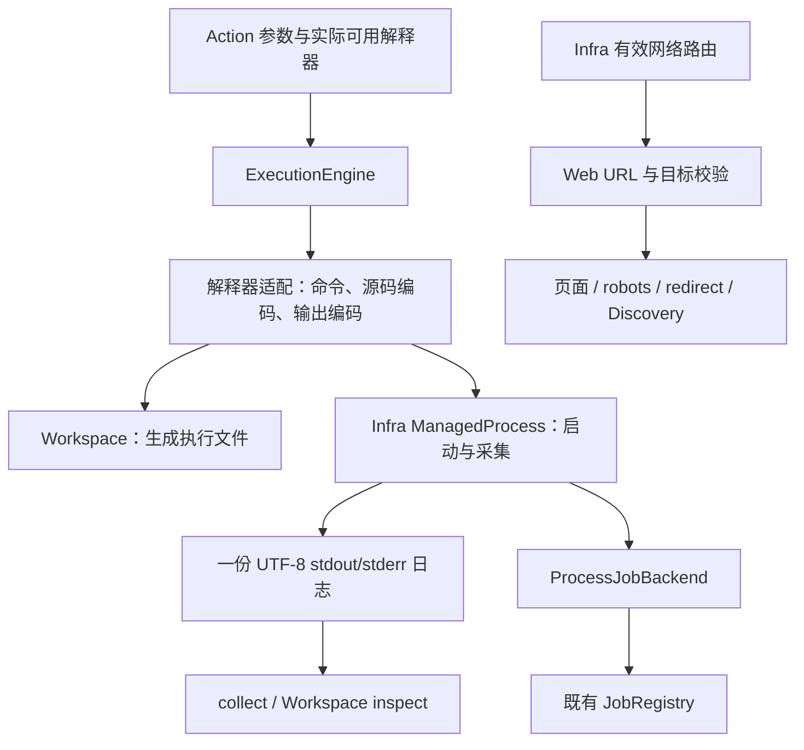

# Execution 与 Web 能力完善执行计划

日期：2026-10-29。

状态：`done`。维护者已确认 D1、D2；P1–P4 已实施，P5 已完成规约核对、文档同步和必要验证。最终 Full 1492 passed、3 deselected，ty 与 git diff --check 通过。计划于 2026-10-29 完成并归档。

复核基线：`e2564cf7`（修复共用 HTML 规范化与异常分类）。依据：[AGENTS.md](../../../AGENTS.md)、[原始轨迹分析](../20261029%20Web与Execution轨迹失败分析.md)、[Execution 设计](../../design/execution.md)、[Infra 设计](../../design/infra.md)、[Web 设计](../../design/capabilities/web.md)。

本计划从现有能力主线和真实问题出发。独立复现用于验证设计，不把历史网址、五次 bash 调用、70 秒或某段诊断脚本变成业务规则。

## 1. 目标与范围

目标是让已有 shell/script 能力正确传递命令、参数和可读输出，并让 Web 的失败分类、网络选择与实际执行路径一致。

保持以下已确认语义：

- Python 继续作为直接脚本解释器；bash、PowerShell、CMD 继续接受 command 和 source_ref。shell 内调用 Python 是已有能力。
- source_ref 表示交给指定解释器的源码快照，不表示自动识别语言或间接调用另一解释器。
- Engine 负责装配，JobRegistry 负责监督，ProcessJobBackend 持有进程资源，Infra 负责平台启动和流采集，Workspace 持有实际文件。
- Action 总时限、Job 生命周期、Turn 收尾、Workspace 不回滚的语义继续使用现有机制。
- 固定文案属于 prompts，正式可配置工具说明与 Skill 属于 assets/Home；有效工具说明只投影当前实际能力。

本计划不包含：副作用结果协议或 timeout 的 retry_same 调整、新增通用 Web 离线成功路径、动态删除 interpreter schema 枚举、语言猜测、批次失败熔断、自动代理切换、关闭 TLS 校验、自动安装 pwsh、修改系统代理、前端实现。最后一次手工停止与导出 timeout 的关系缺少原始控制事件，不据此改写取消控制流。

## 2. 上一轮提交复核

| 项目 | 结论 | 后续处理 |
| --- | --- | --- |
| make_links_absolute | 正确恢复 lxml 外部 API；三个 Web 能力共享修复 | 保留，不增加各提取器补偿路径 |
| HTML 解析异常收窄 | 将明确的解析失败与未知实现错误分开，方向正确 | 保留；不把未知异常重新归为 invalid_html |
| worker main 的 Exception 兜底 | 位于固定进程协议边界，返回稳定 worker_failed 和有界 error_type，合理 | 保留；不扩散到内部函数，也不将 BaseException 纳入 |
| types-lxml | 仅开发期类型声明，能帮助检查第三方 API；不是运行依赖 | 保留；不再修改锁文件或引入新依赖 |
| Discovery 未知错误 → worker_failed | 未知实现错误采用 stop 的方向正确，但分类仍不完整 | P1 补齐已知超时；保留未知错误分类 |
| Discovery seed 失败事实 | 当前只保留 reason，status_code/error_type 被丢弃 | P1 保留有限事实，避免 disposition 失真 |
| Action → Trace | 五次 bash 属于同一模型响应；下一 Cycle 已收到五条失败 | 不修改 Phase/Trace，不增加专用重试规则 |
| 编码建议 | “明确编码，再形成单份 UTF-8 日志”的目标成立 | 细化为配置驱动采集，避免强制包装 PowerShell 脚本 |

本次新增复核证据：

1. 在真实 Crawlee 流程中注入 TimeoutError，回调收到其超时包装，当前返回 worker_failed。库自己的 handler deadline 也会以 TimeoutError 进入失败回调。它们属于已知页面处理时限，不应与 AttributeError 等未知实现错误合并。
2. 在同一流程注入 WebProcessingError(http_status_error, status_code=429)，seed 输出的 facts 变成空对象，最终 disposition 为 change_request；应保留 429，让已有映射得出 retry_same。该事实丢失早于上一轮提交，并非 HTML 修复引入。
3. 同一段带引号的 Python 命令，当前 CMD argv 退出 1；按 Windows 原生命令行传递后，带空格的路径、参数均正确，并返回脚本指定的退出码 7。
4. Windows PowerShell 5.1 的 -File 保留命名参数、switch 和退出码；改成编码命令后把全部 args 当字符串拼接，会将 -Name 变成位置参数。这否定了简单包装脚本以设置 UTF-8 的方案。
5. 当前主机默认执行策略阻止 .ps1；仅对测试子进程加 -ExecutionPolicy Bypass 后可运行。未修改系统策略。该情况需在解释器启动语义中明确处理。

上述都是有界临时验证，未修改业务源码、正式测试或运行配置；没有重新运行历史公网探测。

## 3. 总体结构



不新增执行调度器、日志 owner 或可恢复执行状态机。新增结构只表达当前已有但尚未明确的职责：平台命令行、文本采集和解释器启动适配。

## 4. P1：补准 Web 失败语义与 Execution 能力表达

### 4.1 Discovery 的局部失败

沿 `_PageState` 和现有 failed_request_handler 保留失败 reason 与有限 facts；不存原始异常对象或 traceback，不建立跨页面错误日志。

分类顺序为：

| 输入 | 输出 reason / facts | Action 层解释 |
| --- | --- | --- |
| WebProcessingError | 原 reason、有限 payload | 复用 web_failure_disposition；429 等状态不丢失 |
| Crawlee handler deadline 的 TimeoutError | page_visit_failed，error_type 为明确超时类型 | 既有 use_fallback；不伪装整个 worker 超时 |
| Crawlee UserHandlerTimeoutError | 同上；仅识别已核对的库类型 | 不遍历任意异常链猜原因 |
| 其他异常 | worker_failed，有限 error_type | 既有 stop |

seed 失败时将所保存 facts 传给 WebProcessingError，再由现有 worker/service 白名单投影。非 seed 页面继续保留原有 failed/failure_reason 和有界部分图；不因一个子页面失败新增全局停止机制，也不新增整个异常对象的模型字段。原始 HTTP/OS 异常仍由下载 owner 先归类。

沿现有 Service 的事实白名单处理 status_code、error_type，未知字符串及大块正文不自动透传。必要的新固定反馈放到 `prompts/plugins/capabilities/web.py`。已有 Trafilatura 调用边界的 extractor_failed 有明确替换提取器的语义，本次不机械删除全部宽泛捕获。

### 4.2 Execution 的能力表达

整理 run/start 的正式说明、示例和域 Skill，表达三件事：当前实际可用解释器；command 与 source_ref 的区别；源码由所选解释器直接解释。静态枚举继续表达支持身份，有效描述继续表达本世代可用身份。

示例使用通用任务和直接 Python 脚本，不把 bash 工具链当成所有宿主的默认环境。Windows 网络提示说明 curl.exe 与 PowerShell HTTP cmdlet 的区别、代理环境继承和显式 -Proxy 的适用条件，不写入具体开发端口或本次测试网站。

不追加“失败若干次必须换工具”之类流程约束，不把编码细节变成每次调用都必须填写的步骤。

## 5. P2：明确解释器启动与脚本材料化

### 5.1 解释器适配

ExecutionEngine 保持唯一对外组装门面。将随本次改动增长的解释器分支收敛到包内 `interpreters.py`：一个具体适配对象持有 Interpreter、已解析 executable、有效网络和默认编码，负责构造启动描述。Engine 不再分别维护可产生不一致的 executable/network/encoding 平行字典。

使用现有 Interpreter StrEnum；启动描述使用 frozen dataclass，并在边界校验。无需四个继承层次、动态 registry 或第三方插件发现协议。可用性仍在 generation 装配时解析，保存配置后沿既有 reload 生效。

### 5.2 CMD 命令行

Python subprocess 在 Windows 上把参数列表按 C runtime 规则转为命令行；CMD 的 `/S /C` 解释的是 shell 命令文本，二者不能混用。依据：[Python subprocess](https://docs.python.org/3.13/library/subprocess.html)、[Microsoft CMD](https://learn.microsoft.com/en-us/windows-server/administration/windows-commands/cmd)。

计划在 Infra 的现有进程请求中用互斥类型表示两种启动输入：普通 argv tuple，或带明确 executable 与命令尾部的 WindowsCommandLine。请求字段可统一为 command，所有仓库内调用者一次迁移，不保留 argv/command 兼容别名。WindowsCommandLine 是 frozen 值对象，只用于原生 Windows 启动；POSIX 不解释它。协议进程继续提交普通 argv。

CMD 适配将用户 command 作为完整命令文本交给 `/D /Q /S /C`，补足所需外层引号，不对内部文本再次应用 list2cmdline。禁用 delayed expansion 的启动默认值保持明确；用户仍可在自己的 command 中显式使用 CMD 语法。不启用通用 shell=True，也不自动插入 PowerShell。

source_ref 的路径及 args 使用 CMD 专属参数构造，不能复用 C runtime 的反斜杠引号算法。实现时按真实 CMD 行为验证空格、空参数、引号和常用元字符，不能只断言拼出的字符串。命令文本本身保留 shell 语义；结构化 args 则按脚本参数处理。若原生命令语言对某类参数存在限制，应反馈明确的 ExecutionRequestError，不能静默改变值。

同一 CMD 启动规则也用于 Web worker 内的 Defuddle `.cmd/.bat` 入口，消除其中现有的列表二次转义。共用的 Windows 命令行构造放在 Infra，不从 Web 导入 Execution 内部对象。

### 5.3 源码快照与 PowerShell

源码读取仍由 Home/Workspace owner 完成。Execution 按解释器将 Unicode 源码编码为执行工件，再交给 Workspace 材料化：

| 解释器 | 执行工件编码 | 启动语义 |
| --- | --- | --- |
| Python | UTF-8 | 直接 executable + script + args |
| bash | UTF-8 | 直接 executable + script + args |
| PowerShell | UTF-8 BOM | 保留 -File 和原始参数，不改成字符串 splat 包装 |
| CMD | Windows OEM 代码页 | CMD 直接解释脚本，不把 UTF-8 中文交给默认 OEM 解释 |

`WorkspaceExecutionPort/Service/Engine.prepare_execution()` 将 source_text 改为 source_bytes，复用已有 atomic_write_bytes；Workspace 负责资源写入，不解释语言或选择编码。Home/Workspace 原始资源保持原样；Job 的 source 文件是面向解释器的执行工件，可能是非 UTF-8，精确检查执行工件时需按该解释器的源码编码读取。原 source_ref 仍可作为通用正文入口，但不能把后来修改过的原资源冒充本次执行快照。正式 stdout/stderr 日志统一为 UTF-8。

源码无法按所选解释器编码时，在进程启动前返回可修正失败，建议改用能表达该源码的解释器或修改源码，不使用 errors=replace 写坏程序。普通 `.ps1` 的 BOM 行为依据 [Microsoft 字符编码说明](https://learn.microsoft.com/en-us/powershell/module/microsoft.powershell.core/about/about_character_encoding?view=powershell-5.1)。

依照项目受信宿主前提，Windows PowerShell 的执行工件使用仅对子进程生效的 `-ExecutionPolicy Bypass`，不设置系统策略；宿主有更高优先级限制时保留真实失败。inline command 保留既有 -EncodedCommand；不为设置编码改写用户脚本的 param、作用域、命名参数或 exit 行为，不新建 CLIXML 解析层。

普通 argv 应允许合法空参数，非空要求只约束 executable；当前 ManagedProcessRequest 对所有参数非空的校验需随启动协议一并纠正。NUL 和无效类型仍在公共边界拒绝。

## 6. P3：明确输出编码，统一日志与必要结束

### 6.1 配置和 Action 参数

增加 `execution.interpreters.<name>.output_encoding`，表示该解释器正常输出的编码。可用 `platform` 表示当前 Windows OEM 代码页、其他平台 UTF-8；其他值须为可用文本 codec，不接受字节到字节转换 codec。platform 标识有明确类型，codec 名称在配置/请求边界规范化。

| 解释器配置 | 默认值 | 说明 |
| --- | --- | --- |
| Python | utf-8 | 保留 PYTHONIOENCODING/PYTHONUNBUFFERED |
| bash | utf-8 | 使用其常见 UTF-8 文本约定，可显式配置 |
| powershell | platform | 与当前 powershell.exe 开发配置一致；改用 pwsh 时显式配 utf-8 |
| cmd | platform | 处理当前已复现的 Windows 中文诊断 |

run/start 增加可选 `output_encoding` 覆盖：调用值优先于 interpreter 配置。它仅选择如何解释本次 stdout/stderr，不更改子程序行为，也不控制执行工件或 stdin 编码。正常调用省略该字段；已知 shell 内启动的程序输出 UTF-8 时可明确覆盖。

无效配置使用 ConfigError，经现有装配 bridge 处理；无效 Action 覆盖使用 ExecutionRequestError/change_request。启用解释器的编码在启动 Job 前已解析为具体 codec，不把 platform 交给采集线程临时推断。

一个流应有明确编码。任意子程序混用多种编码无法由单一解码器可靠恢复，由命令统一输出或拆分调用；不加入逐次猜编码、BOM 猜测链或自动重跑。stdin 继续遵循已有 UTF-8 字节契约。

配置写入仍走 Infra 配置设施；新增字段进入配置 catalog 与 Endpoint 投影，应用方式仍为 apply/reload。不增加专用设置 API，不改前端。

### 6.2 单一采集实现

ManagedProcessRunner 将 stdout/stderr 接到二进制管道；每个流由有界读取的采集器使用指定增量解码器处理，并追加写入唯一的 UTF-8 stdout.log/stderr.log。所有文本捕获使用同一实现，默认 codec 为 UTF-8，固定 Action worker 无需选择编码。

采集器是 Infra 的具体资源对象，负责管道、增量解码器、文件和完成事件；不拥有 Job 状态、Turn、重试或 Runtime bridge。Windows/POSIX 复用文本采集，现有平台进程容器保持职责。可新增 `infra/process/capture.py`，不在 Execution 私有化通用 I/O。

- 按当前可取得的有界块读取、解码、写入、刷新，不等待缓冲区填满、换行或 EOF 才发布已经解码的完整字符；不使用无界字符串缓冲，不额外保存 raw 日志。
- 多字节字符跨读取块时由同一增量解码器保留尾部，EOF 后才完成解码。
- `collect` 的 cursor 继续是规范化日志的字符位置；同 cursor 重读不重跑进程。
- `stdout_bytes/stderr_bytes/max_output_bytes` 统一解释为实际 UTF-8 日志字节数；现有轮询监督继续负责进程输出上限。
- 有界正文读取不得把字节上限截断的半个 UTF-8 字符立即写成替换字符，避免续读位置不稳定。
- 未遵循已声明编码的字节保持有限替换行为，不自动改判为别的编码。采集 I/O 失败与文本替换分开处理。

StdioProcess 的 MCP/ACP 协议管道保持原始字节和协议已有编码，不进入日志转码路径。进程请求字段迁移只同步构造调用，不改变协议通信。

### 6.3 运行期间的状态查询和输出读取

维护者明确要求：Job 仍在进行时，Agent 可以主动探查其状态和已有输出。这是现有能力，编码与采集改动必须保留并验证，不以终态或 finish 作为读取前提。

现有链路为 execution.start 返回 Job → Agent 可做其他行动或 core.wait → 定时/匹配事件恢复同一 Turn 的后续 Cycle → core.job.status 与 execution.collect → 判断继续执行、提供输入、停止或再次等待。Agent 也可在未调用 wait 时直接查询；wait 负责安排后续决策时机，不控制 Job 运行或输出可读性。

- core.job.status 返回当前监督快照和 backend 详情，例如当前状态、退出事实、已采集字节数与资源引用。该调用不等待 Job 终态。
- execution.collect 在 running 和 terminal 状态都可使用，返回当前已采集输出的有界页面与续读 cursor；不停止 Job、不等待 EOF，也不主动排空全部未来输出。
- 采集器在进程运行期间持续写入 UTF-8 日志。读操作只做短时读取，不持有整个进程生命周期的锁，不调用 finish/terminate，不 join 尚在运行的进程或采集器。
- 只有多字节字符尚不完整的尾部需要留待后续字节补全；已经完成的字符及时可见。子程序尚未写出或仍缓冲在自身内存里的内容不属于已取得输出，不能由没有新输出推断它已结束、卡死或正在请求输入。
- 同一 cursor 可重读当前页；按返回 cursor 可取得后续追加内容。一次返回空页不表示 EOF 或 Job 完成，应结合状态判断。

`core.wait(event_kind="job", timeout_seconds=30)` 表示 Job 终态/待答事件与 30 秒时限二者先到者恢复 Turn；定时醒来时 Job 完全可以仍在 running。当前普通 stdout/stderr 追加不自动触发新的 Cycle，仍可通过定时醒来主动 collect；按需监听 Workspace 变化沿现有显式事件过滤。无需为可读的运行中输出增加逐块唤醒或第二套定时机制。

### 6.4 进程退出后的收尾与最终输出

这里的“进程结束”只指操作系统进程退出或被停止后的资源收尾，与 Agent 的 core.wait 是不同层次。运行中的输出按上一节持续可读；只有在承诺最终输出完整、交付稳定终态时，才需要收齐剩余内容。

管道采集不能仅凭主 PID 退出就把已有输出当成最终完整结果：后代可能仍持有流，采集线程也可能尚未写完。需要在现有 ManagedProcess 中明确必要 finish 与附属 close：

1. 根进程自然退出或被停止后，沿现有 ProcessScope 停止并确认剩余后代；保留真实根退出码。
2. 等待两个采集流 EOF，完成解码、写入与必要 flush，join 采集器。
3. 此后完整输出已收齐，终态结果可稳定读取；不是此时才允许读取已有输出。必要采集失败影响结果。
4. 附属 close 再关闭句柄、清理临时目录；调用方提供的 Workspace 日志继续保留。附属清理诊断不覆盖已完成主结果。

在现有对象上增加幂等 finish 边界，不另建业务状态机。close 调用 finish 后清理；terminate 继续表达停止执行单元。finish 使用已有生命周期的有界等待，不能在持有采集写锁时 join，也不能先删除日志再读输出。

两个真实消费者必须同步：

- ProcessJobBackend 在 poll 观察到根进程结束时先 finish 采集，再判断最终输出上限和构造终态快照；close_execution 复用同一幂等 finish 并释放执行资源。JobRegistry 在 close_execution 后发布该快照，不新增监督层。不能在 Registry 已取得成功快照后才修改 backend 的输出限额结果，也不能只因根进程已退出就漏判。
- ControlledProcessRunner 当前在 with handle 内、close 前读取 stdout。需要先 finish、再读取 ProcessOutcome，最后由 close 清理临时目录；否则 Web/Resource 可能取得不完整 JSON。

新增有限 Process 层采集异常；Job owner 映射为既有监督失败，固定 worker 适配器在 ProcessOutcome 中使用一个明确的 output_failed 状态，并由 Web/Resource owner 映射到各自局部 worker 失败。它不冒充非零退出、启动失败或超时，不暴露原始 I/O 异常。采集失败必须使进程停止并完整回收，不能让无人读取的管道无限阻塞，也不增加自动恢复链。

## 7. P4：Web 按实际路由确定解析责任

### 7.1 决策 D1

状态：`confirmed`。维护者已确认按计划实施，采用“按实际路由处理”：

| 路由/目标 | 推荐行为 |
| --- | --- |
| URL 不合法、userinfo、非 HTTPS | 继续拒绝 |
| localhost、显式非 global IP | 无论代理与否继续拒绝 |
| 域名直连，包括命中 no_proxy | 本机 DNS 校验，所有地址须为 global |
| 域名实际通过代理 | 代理负责目标解析，不用本机 DNS 结果提前否决 |
| redirect 改变目标或命中 no_proxy | 对新 URL 重新选择路由和校验 |

这明确改变原先“所有请求均要求本机 DNS 为公网地址”的策略。TinySoul 无法验证代理最终连接的目标 IP；代理模式信任已配置代理的解析和路由能力，不声称仍提供同等的目标地址验证。D1、D2 均已确认并实施。

### 7.2 路由与校验的 owner

Infra ResolvedNetwork 提供针对 URL 的有效代理查询，返回实际 proxy 或 None，沿现有 HTTP/HTTPS 与 no_proxy 语义计算。no_proxy 在构造时解析为内部规则，HTTP transport 与 Web 使用同一个查询；不在 Web 再写一套匹配，不调用 HTTPX 私有 URLPattern。默认端口 mount 的取舍见 D2。

规则保留当前能力：精确 IP、域名及子域、可选端口、全局绕过；不顺带增加 CIDR、PAC、SOCKS 或系统代理读取。规则匹配、默认端口和公开 transport 的行为由一致性测试覆盖，确保查询结果就是实际传输路由。主机 IDNA 规范化复用现有 HTTPX 公开 URL API，不新增依赖或第三方私有匹配。

Web 的 URL 语法规范化与连接前目标校验明确分工：前者无网络副作用；后者读取有效路由，必要时调用 resolver。每次实际访问前校验一次，不在同一次 GET 前后重复解析相同 URL。已完成响应的 final_url 只做对应的规范化，不再次发 DNS 查询后否定已取得的响应。

Fetch、robots、Discovery seed 和递归访问都显式传递同一 ResolvedNetwork；Discovery 的注入 fetcher/resolver 继续服务测试，不把 network 放进模型业务请求。worker 局部组装负责把有效配置传至这些入口。公共边界仍归 Web，不下沉为 Infra 的“禁止私网”通用政策。

诊断保持有限事实；不把代理凭据、全部环境变量或完整 DNS 地址清单写入模型。已有 HTTP error_type/status_code 足够时不新增通用诊断框架。

### 7.3 实施中发现的决策 D2

状态：`confirmed`。维护者在进一步讨论 no_proxy 含义、当前配置与改动范围后，确认采用共享路由 transport，继续完成执行计划。

安装版本的 HTTPX/httpx2 会把请求 URL 的默认端口规范化为 None，但 `all://*example.com:443` 的 mount pattern 仍保留 443。使用两套库的公开 Client/MockTransport 复现：`https://example.com/` 和显式 `:443` 均走代理，未命中 no_proxy；这并非网络连通性或 DNS 故障。将 pattern 改成不带端口又会误将非默认端口一并绕过。因此原计划“仅生成 mount，同时正确处理默认端口并保证查询与实际传输一致”无法直接实现。

已采用 Infra HTTP 实际路由 transport：每次请求从同一个 ResolvedNetwork 查询选择代理或直连，复用对应 HTTPX/httpx2 的公开 sync/async transport 与客户端生命周期。沿用已有 helper 入口，调用 owner 不变；不复制 no_proxy 匹配，不增加自动代理切换。改动涉及 `infra/http.py` 及其路由一致性测试，默认端口、非默认端口、redirect 均按统一规则处理。Kimi 同步客户端及 Anthropic model 查询显式传递 SDK 的连接限制，防止装配变化丢失调用 owner 的配置。

当前开发 no_proxy 仅包含本机地址，没有带端口规则。默认端口问题是实施核查发现的已有缺陷，不能作为原轨迹失败原因；本次修正用于保证 Web 校验与实际 HTTP 路由共用一个决定。开发代理配置保持原样，Execution 继续仅传递代理环境提示。

## 8. 改动范围预览

这是中等规模的后端改动，主要工作量在文本采集及其两个消费者。具体文件数不作为完成标准；不进行目录级重构。

| 区域 | 预计文件 | 预计变化 |
| --- | --- | --- |
| Web 失败 | backends/discovery.py、errors.py（仅需映射时）、所属 prompts | 超时分类与 seed facts 保留 |
| Execution 适配 | engine.py、config.py、actions.py；新增内部 interpreters.py | 单一解释器适配、编码配置与调用覆盖、CMD 启动 |
| 通用进程 | infra/process/managed.py、windows.py、__init__.py；新增 capture.py | 类型化启动、采集、finish/close、模块异常 |
| 固定 worker | kernel/action/backends/subprocess.py，Web/Resource service，Web worker | 先完成采集再解析结果；输出失败；Defuddle CMD 入口复用 |
| Workspace | engine.py、services.py | 执行源码工件改为明确 bytes，由 owner 写入 |
| 协议调用者 | infra/process/stdio.py、MCP/ACP 构造处及相关测试 | 仅统一进程请求类型；不改变协议 I/O |
| 配置与文案 | config/catalog/execution.toml，standard/development execution.toml，run/start catalog、execution prompts/Skill | 输出编码字段、能力说明、配置投影 |
| 网络 | infra/network.py、http.py，Web network/discovery/worker，Anthropic models | 单一路由匹配、代理与直连分别校验；SDK 连接限制传递 |
| 文档 | design/execution.md、infra.md、capabilities/web.md，endpoint/configuration.md | 只在实施后同步当前事实 |
| 测试 | 对应 Infra、Execution、Web、Workspace 与固定 worker 测试 | 保护真实参数、编码、结束和路由契约 |

不新增第三方运行依赖。Endpoint 沿既有配置读写与有效 Action schema 投影支持新增字段，无新路由、任意文件 API 或外部 Action 执行 API。前端通过配置投影消费能力，后端不改 visualization。

## 9. 请求与效果预览

以下为已实施接口的调用示意：

```json
{"interpreter":"python","source_ref":"workspace:scripts/report.py","args":["two words"]}
```

继续直接执行 Python，无需 shell。PowerShell 的 `.ps1` 保留命名参数和退出码；CMD 的带引号路径不再被 C runtime 转义破坏。

```json
{"interpreter":"cmd","command":"python -c \"print('hello')\"","output_encoding":"utf-8"}
```

明确选择已知子程序的输出编码；正常 CMD 中文诊断使用默认 platform，无需模型每次填编码。默认调用与覆盖都生成 UTF-8 日志，collect 和 Workspace 读取同一内容。

```toml
[execution.interpreters.powershell]
enabled = true
executable = "powershell"
output_encoding = "platform"
```

改用 pwsh 时可明确设置 executable 与 utf-8，项目不自动安装或猜测版本。输出编码不改变脚本 stdin 或 source_ref 所指资源。

Web 行为变化：Discovery 429 保留 status_code；已知页面超时不再是 worker_failed；真正未知错误仍为 worker_failed。代理访问的域名不因本机 DNS 非 global 而提前失败，实际连接失败仍如实返回局部结果。

## 10. 实施顺序、验收与提交边界

| 步骤 | 状态 | 实施内容 | 完成条件 |
| --- | --- | --- | --- |
| P0 复核与计划 | done（仅本步骤） | 重新阅读规约、审查提交、核对消费者、临时复现 | 本文与原分析互链，真实发现和假设分开 |
| P1 Web 失败与能力表达 | done | 超时/facts，Execution 文案与示例 | 正确 disposition；当前能力信息保留；无 Phase/Trace 改动 |
| P2 启动适配与源码工件 | done | 解释器内部适配、CMD 原生命令行、源码 bytes、PowerShell 参数语义 | 真实参数与退出码正确；固定 worker 的 CMD 入口同步 |
| P3 编码与采集生命周期 | done | 编码配置/覆盖、UTF-8 日志、finish、调用者和 Endpoint 同步 | 输出完整；分页一致；取消与自然结束都完成资源回收 |
| P4 网络路由 | done | Infra 查询与 Web 校验协作 | 实际传输与查询一致，redirect/no_proxy 均正确 |
| P5 总体验证与归档 | done | 聚焦、Fast、Full、ty；文档及改动复核 | 所有已纳入项目完成，排除项明确，已归档 |

P1–P3 先完成，P4 在 D2 确认后实施；最终与前述改动共同验收。每个步骤同步设计及必要 Endpoint 说明，不在未实现时先改 design 文档宣称生效。

提交按三个行为边界组织：Web 失败修正；Execution 启动及文本采集（P2/P3 一起验收）；Web 代理路由。不以拆提交为理由保留错误兼容别名或不完整消费者迁移。

## 11. 验证计划

测试只保护契约及本次真实风险，不复制导出轨迹，也不新增已明确排除的通用 HTML 离线成功路径。

| owner / 边界 | 最小必要验证 |
| --- | --- |
| Web Discovery | 429 facts 保留；已知超时与未知错误区分；seed 失败与子页面部分图语义 |
| 进程启动 | 真实 CMD 带空格路径/引号/参数/退出码；普通 argv 空参数；现有进程容器测试 |
| 源码适配 | PowerShell 非 ASCII、命名参数、switch、exit；CMD 中文执行工件；无法编码时不启动进程 |
| Infra 采集 | UTF-8 和非 UTF-8 字节按明确 codec 转换；字符跨块；流结束前后读取；双流及时排空；写入失败的资源回收 |
| 运行期间探查 | 子进程先输出一段并等待明确信号，保持 running；此时 status/collect 可及时返回，含未换行的完整字符；再次输出后按 cursor 取得新增部分，读取不触发 finish 或停止 |
| 结束协作 | 根进程退出但后代持有流；停止后日志收齐；必要采集失败不可发布成功；附属清理不覆盖主结果 |
| 固定 Action worker | finish 后读取完整结构化输出；输出失败转局部结果；取消与超时保持原语义 |
| Execution + Workspace | run/start 共用能力；多页/重复 collect；日志与 Workspace.inspect 内容一致；最终输出限额 |
| Wait 协作 | Job 继续 running 时定时恢复同一 Turn；恢复后能查询已有输出并再次等待；Job 终态/待答仍可提前恢复，普通输出不强制新增 Cycle |
| 配置及 Endpoint | output_encoding 可读写、校验和 reload；有效 schema 有可选覆盖；不写个人路径 |
| 网络 | 直连/代理/no_proxy/端口/redirect；代理域名不调用本地 resolver；字面私网仍拒绝；路由查询与真实传输一致 |

编码和启动机制由 Infra/Execution owner 覆盖一次，跨模块只保留代表性协作路径。参数/字节/退出码属于稳定机器语义可精确断言；提示文案和可编辑示例不做完整快照。Windows 专属行为在本机真实验证，其他平台验证共用采集及 argv；不可用 shell 不伪造测试通过。

实施后的命令：

```powershell
uv run --locked --extra dev python scripts/test.py --suite full tests/infra/process tests/plugins/execution
uv run --locked --extra dev python scripts/test.py --suite fast tests/plugins/capabilities/web
uv run --locked --extra dev python scripts/test.py
uv run --locked --extra dev python scripts/test.py --suite full
uv run --locked --extra dev ty check
git diff --check
```

实际还需将已改动的 Workspace、固定 worker、配置和网络测试纳入相应聚焦运行。最终 Full 覆盖非 external 本地门禁；公网验证仅作为有界人工检查，不能代替契约测试，也不将当前代理、目标网站或 TLS 环境固定进测试。

## 12. 实施准备与完成检查

- [x] 复核 e2564cf7，确定保留项与需要补准的分类。
- [x] 确认直接 Python、现有 Action/Job/Workspace 分工继续保留。
- [x] 复现 CMD 引号、PowerShell 参数/编码，以及 Discovery facts/timeout 问题。
- [x] 核对固定 worker 与协议进程消费者，避免只修 Execution。
- [x] 明确配置、模型参数、Endpoint、文档与测试范围。
- [x] 记录 D1：按实际代理／直连路由处理域名解析。
- [x] 完成 P1–P3。
- [x] D2 确认后完成 P4。
- [x] 完成 P1–P4 的必要验证、diff 审查、文档同步与总体核对。
- [x] 逐项确认后标记 done，在文件名加入 -done- 并移至 analysis/done。

实施接口采用代码组织中的等价命名，保持既定所有权、参数和结束语义；网络决策均已确认。

## 13. 实施与复核记录

- P1：Discovery 保存 seed 的 reason/facts，识别 TimeoutError/UserHandlerTimeoutError 为既有 page_visit_failed/use_fallback；429 保留 retry_same，未知错误继续 worker_failed/stop。正式工具说明和域 Skill 补充可用解释器、直接 Python、运行中 collect、定时探查及 Windows curl.exe/PowerShell 代理差异。
- P2：ExecutionEngine 使用单一 InterpreterAdapter 字典；共享进程请求统一为 command（argv 或 WindowsCommandLine），Stdio 保持协议字节。CMD 的原生命令行构造供 Execution 和 Defuddle 共用，PowerShell 保留 -File 参数和子进程 Bypass。Workspace 准备接口接收 source_bytes，补全 .cmd/.bat 文本分类。
- P2 真实验证追加：CMD 工件使用 CRLF，避免 LF 使部分命令丢失字符；原始源码仍保持原样。CMD 结构化 args 对双引号、百分号和换行明确拒绝，普通 argv 保留空参数。
- P3：公共采集器增量解码、规范换行并写入唯一 UTF-8 日志；运行中已完成字符无需换行/EOF 即可读取。finish 与 close 分工明确，固定 worker 先收齐再读取，Job 在终态快照前检查最终输出上限。采集失败与未完成资源释放分别使用 ProcessOutputError、ManagedProcessCloseError，Infra 无 Runtime bridge。
- 配置：新增解释器 output_encoding、run/start 可选覆盖、标准/开发配置及配置 catalog；Endpoint 复用现有查询和 PATCH/apply/reload。公开 schema 未删除未启用解释器枚举，动态 hint 沿既有实现。
- 文档：同步 Execution、Infra、Web、Workspace 和配置 Endpoint；P4 实施后补充路由匹配、直连 DNS/代理解析责任及 no_proxy 有效端口语义。
- P1–P3 验证记录：实际 Windows Python/PowerShell/CMD 参数、非零退出、中文源码与诊断；跨块 UTF-8/GBK、双流采集、无换行实时输出、timer 恢复后探查、stdin 继续执行、最终限额和采集失败回收均已覆盖。配置接口校验、固定 worker 完整 JSON 与 Web/Resource 局部失败同步覆盖。当时 Fast 1326 passed，Full 1469 passed、3 deselected（run：847a432d1af7400d89aaffdd4976feba），ty 与 git diff --check 通过。新增 Resource 测试的输入类型在首轮 Full 中暴露错误，修正为真实 DOCX 后单独及完整门禁通过，不改变业务断言。
- AGENTS 核对：没有新增调度器、Job 状态机、Runtime 原因、源码语言猜测、代理自动切换或逐块模型唤醒；新固定模型文案归 prompts，配置/工具/Skill 文案归原 owner；frontend 未修改。采集线程的异常捕获是将线程失败交回所属生命周期，不形成业务恢复链。

## 14. P4 实施与整体语义核对

- P4：移除生成 no_proxy mount pattern 的平行解释，改为 ResolvedNetwork.proxy_for_url 单一判断；HTTPX/httpx2 同步与异步适配只选择和关闭第三方 transport，不处理重试、业务失败或 Runtime 转移。有效端口同时覆盖省略及显式 80/443；规则也覆盖子域、IP、IDNA 与全局绕过。
- Web：normalize_https_url 只做语法和规范化；validate_public_https_url 负责显式目标及直连域名检查。每次访问前检查一次，响应 final_url 不再次解析。Discovery 从 worker 接收 network，向 robots、seed 和递归访问传递同一 network/resolver，不保留入口重复 DNS 校验或 partial 绑定。
- 失败：无效网络配置仍为 ConfigError；内部路由调用契约失败为 NetworkTargetError；Web 已知 URL/DNS/HTTP 失败沿既有局部 WebProcessingError 和 disposition 返回。没有新增 Runtime 原因或泄露代理、DNS 清单及原始异常正文。
- 生命周期：各客户端保有连接生命周期、timeout 和 retry 所有权，路由适配在客户端关闭时释放对应 transports。同步 SDK 与异步 SDK 的既有连接限制由调用方显式传入，直连及代理共用相同设置。
- P1–P3 复核基线为维护者已提交的 43cea400：直接 Python 和解释器参数语义保留；源码工件由 Workspace 写入 bytes；OutputCapture 保有唯一 UTF-8 日志；Job running 的 collect/describe 不调用 finish，定时恢复后可读取已有输出；进程终态与固定 worker 读取最终结果前完成必要采集。
- 边界核对：Infra 不拥有公网访问政策，Web 不解释代理字符串；进程只接收环境，Execution 不承诺外部程序自动遵循代理。未修改开发代理地址、系统设置、Action/Job/Turn 调度、前端或外部 API 字段；未增加运行依赖。
- 本轮聚焦验证：Infra/Web/LLM adapter/ModelServices/MCP 共 242 passed、1 deselected（run：d3e6b9e3fcc0472b8522f3a0e348cdc2）；Fast 1351 passed、144 deselected（run：7ef3d7d6cbda4bcf8b068370409dbeb3）。最终 Full 1492 passed、3 deselected（run：98ffb20b24b74fb592a020f6d0f06c11），包括 SDK 连接限制的最终补齐、真实 Windows 进程协作和安装包验收；ty 与 git diff --check 通过。未新增公网探测，external 按本地门禁规则不执行。

| 计划项目 | 实现与验收依据 | 核对 |
| --- | --- | --- |
| P1 第三方调用与失败分类 | 共用 HTML 规范化；Discovery 的 429 facts、已知 timeout 与未知错误分类测试；原 Trace 已保留 action 反馈 | 通过 |
| P2 解释器与工件 | InterpreterAdapter、Infra CMD 启动、Workspace source_bytes；真实 Windows 参数、中文、退出码测试 | 通过 |
| P3 运行中探查与结束 | 增量采集、运行中 collect/定时唤醒、stdin 继续执行、最终日志和输出限额、固定 worker finish 协作测试 | 通过 |
| P4 统一网络语义 | 路由查询与四种客户端实际传输一致；80/443/非默认端口、redirect、IDNA、关闭、Web DNS 分工与 Discovery 真实下载主线测试 | 通过 |
| 配置与设计同步 | Execution 输出编码的既有 Endpoint 覆盖；Infra/Web/配置文档解释代理与 no_proxy 的正式语义 | 通过 |
| 原轨迹证据边界 | 保留手工停止事实及历史环境未知；不把默认端口缺陷或当前网络探测推定为历史原因 | 通过 |
| 排除项 | 不增加副作用协议、通用离线成功路径、代理切换、语言猜测或新调度器 | 通过 |
