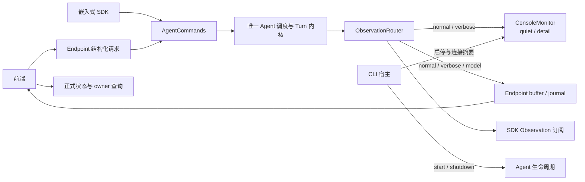

# Console 监控与 CLI 输入收敛执行计划

日期：2026-11-11

Status: `done` (implementation, documentation sync, and validation completed)

## 1. 目标与确认基础

本计划基于重新读取的 `AGENTS.md`、当前 Agent/Runtime/Gateway 实现、Endpoint 协议、前端活动与 Trace 消费，以及相关测试编制。用户已确认：内部三层 Observation 与前端协作合理，结构化 Endpoint 和 SDK 输入继续保留；需要清理的是早期以终端聊天和终端调试为中心的设计。

目标是让 `tinysoul start` 启动一个由前端交互的后端服务，Console 作为轻量运行监控器：

- `quiet` 显示简约的 Agent、环境与宿主信息，以及必要失败摘要。
- `detail` 在此基础上显示少量执行进度。
- Console 模式独立于 Observation 传输级别，不改变前端数据、模型细节回放或 SDK 订阅。
- CLI 保留项目初始化、服务启动和试验数据重置；清除终端聊天、命令词解析和一次执行入口。
- 调度、业务状态、必要收尾继续由已有 Agent、Turn 和各 owner 负责。

本轮只新增本执行计划。下述目标类型、命令和行为在实施完成前均不代表当前能力。实现、文档、前端协作和验证全部核对后，才标记 `done` 并加入 `-done-` 文件名标记，移动至 `docs/analysis/done/`。

## 2. 当前实现与问题依据

| 位置 | 当前实现 | 本次需要处理的边界 |
| --- | --- | --- |
| `tinysoul/runtime/observation.py` | `ObservationLevel.NORMAL/VERBOSE/MODEL`，不可控制业务的事件信封 | 保留；详细度不等于错误等级 |
| `tinysoul/agent/observation/outputs.py` | 每 route 有独立级别，同时保留 router 全局 mode、sinks 简写及聚合 mode | 收敛到显式 route，去掉与 Agent output 配置相连的全局默认 |
| `tinysoul/agent/config.py` | `OutputSettings`、输入命令词和 `interactive` 与 Agent 设置混合 | 删除终端专用配置，保留实际调度配置 |
| `tinysoul/gateway/console.py` | `turn.output` 完整写 stdout；其它事件按 message 加 payload JSON 写 stderr | 改为有选择的短监控行，不再打印回答和模型正文 |
| `tinysoul/gateway/cli.py` | start 同时装配 Terminal 与 Endpoint；`--once` 关闭 HTTP、watcher、定时来源 | start 收敛为唯一服务启动路径，移除一次执行分支 |
| `tinysoul/environment/inputs.py`、`sources/terminal.py` | 文本输入协议、读线程、EOF 命令和实际受理回执 | 唯一正式 source 是 Terminal；移除整套终端专用协议与生命周期接线 |
| `tinysoul/agent/dispatch/inputs.py`、`ingress.py` | 解析普通文本、exit/stop、reply/grant/reflection，再调用 `AgentCommands` | 删除已无消费者的语法和转发层；共享 typed 命令门面保留 |
| `tinysoul/gateway/endpoint/engine/runtime.py` | 结构化 requests 与旧 input/control 并存，前者也经 ingress.commands 转发 | 结构化命令直接依赖窄命令协议；去除 raw input/control |
| `tinysoul/gateway/endpoint/host.py` | 独立 MODEL route；稳定 server、buffer/journal 与重绑 | 保留，不受 Console 模式影响 |
| `visualization/src/app/connection.ts` | 实时 WS 显式请求 `mode=model`，事件触发 owner 重读及活动展示 | 保留数据路径；删除仅服务旧命令适配器的失效通知分支 |
| `visualization/src/features/chat/live/activityBuffer.ts`、`features/trace/` | 活动缓冲裁剪模型事件；详情及导出按需读取 model 事件 | 保留，Console 不再承担这一调试职责 |
| 前端 `SystemPage.tsx`、catalog 翻译 | 固定展示 `agent.interactive`、命令词与旧 output 配置 | 同步清理已移除字段，避免空行和过期描述 |
| `visualization/test/e2e/backend_server.py` | 用 `OutputSettings(MODEL)` 和 `with_output_sink(events)` 装配 | 改为显式 MODEL route；否则后端接口清理会破坏真实联调测试 |

补充核对：

1. 当前前端未调用 `/v2/input` 或 `/v2/control`，正常聊天使用 `/v2/requests` 及其 append/reply/grant/cancel 接口；Reflection 也复用 typed 请求。
2. `agent.command.accepted/rejected` 只由旧输入解析链发布，不能把它们描述为所有 SDK/Endpoint 命令的统一受理事件。删除该链后清理消费者，不建设新的通用命令事件总线。
3. `program.started/completed`、`turn.started/completed` 当前在 VERBOSE 层，因此 Console 的 quiet 不能简单对应 NORMAL route。
4. `runtime.trap` 还表达正常结束、取消和恢复位置转移，不是一条通用错误日志。失败依照 owner 的结果和稳定分类解释。
5. `runtime.source_status` 当前主要报告来源故障，不保证每次启动/停止都有对应事件。启动环境摘要应读取已有 SDK 状态，不能仅靠事件猜测。
6. `docs/endpoint/events.md` 描述默认订阅 verbose；实际 HTTP/WS 服务端省略 mode 时均为 normal，而前端实时流显式订阅 model。实施时准确写明这三处现状，不借此调整传输策略。
7. `tests/agent/observation/test_outputs.py` 混有 Console 测试；`tests/agent/dispatch/test_inputs.py` 同时覆盖解析器和仍有价值的 typed 命令行为。不能整文件删除有价值的 owner 测试。

## 3. 目标边界与数据流



- Runtime 继续定义 Observation 信封和详细度；业务 owner 按已有事实发布事件。
- Agent 继续拥有唯一调度、typed 输入、Observation 分发与 SDK 订阅。
- Gateway 负责命令行参数、宿主生命周期、Console 展示与 Endpoint 协议适配。
- Console 只接收观察与宿主摘要，不读取私有 Context/Session、不轮询业务、不维护 Turn/Job 状态表。
- Endpoint 状态继续来自服务和句柄，前端事件 gap 仍通过 owner 读取恢复。Console 文本不是前端协议，也不是 Trace 导出来源。
- Environment 保留文件监听、定时等待和生命周期服务；`EnvironmentEvent`、插件来源、SDK `publish` 与 Job stdin 不属于本次删除范围。

## 4. Console 设计

### 4.1 两档模式与配置位置

在现有 `tinysoul/gateway/console.py` 内定义 `ConsoleMode(StrEnum)`，仅包含 `quiet`、`detail`；将 `ConsoleOutputSink` 改为 `ConsoleMonitor`。沿用现有 `OutputSink.write(ObservationEvent)` 协议，不新增 Console 专属事件总线。

CLI 参数为 `--console quiet|detail`，缺省 `quiet`。模式属于启动此次进程的展示选择：

- 直接从 CLI 传给监控器；SDK 嵌入方不自动安装 Console。
- 不新建 `[gateway.console]`、Console `.env` 字段或前端设置项。
- 删除 `agent.output`，不迁移成另一套持久配置或 process_shell 投影。
- 不保留 `--mode` 兼容别名，也不将 quiet/detail 加入 `ObservationLevel`。
- 模式在本进程内固定；需要切换时重新启动。没有实时切换和偏好同步需求。

这比上一轮提出的持久 `[gateway.console]` 更贴合本轮目标：只有一个本地展示选项，无需配置保存、候选激活、Settings 展示和重载规则。

### 4.2 展示矩阵

| 信息 | quiet | detail | 数据来源与说明 |
| --- | --- | --- | --- |
| 后端启动、监听地址、数据目录、活动日 | 简短显示 | 同 quiet | CLI 已有参数、Endpoint 实际监听结果、启动后的 SDK 状态 |
| 环境来源初始状态 | 一次摘要 | 同 quiet | `Agent.status().sources`，不探测模型供应商或网络连通性 |
| 重启、关闭及清理失败 | 简短显示 | 同 quiet | 宿主操作真实开始/完成结果；失败只给有限分类 |
| 配置激活、日切完成/恢复/失败 | 结果摘要 | 加开始进度 | 已有 config/daily 事件；不打印配置值 |
| 来源故障、Turn 失败 | 简短摘要 | 同 quiet | `runtime.source_status`、`turn.failed` 等 owner 结果 |
| Turn 开始/结束、等待回复/补额 | 不显示常规进度 | 显示身份、状态与必要关联 ID | turn 事件，不显示问题、输入或回答正文 |
| Reflection 执行 | 仅失败摘要 | 显示情景、目标日、开始/结束 | 复用 reflection/turn 事件；不打印 instructions 和资源正文 |
| Phase / Action | 不显示 | 显示阶段、动作身份和结果状态 | 已有 scope、事件名及少量字段 |
| LLM / 专用模型 | 不显示普通进度 | 显示调用开始、完成、重试及有限原因 | 使用 verbose 元信息，选定一组主线事件避免同次调用重复多层打印 |
| Runtime Trap | 仅根 Agent 结束时可显示中性原因 | 中性显示 reason 与 transfer 摘要 | 正常 END、取消或恢复不被标为失败 |
| 回答、模型请求响应、Action 参数及大结果 | 不显示 | 不显示 | 完整内容由前端和 Trace 提供 |
| Workspace 逐文件变化、Context 安装/内容、逐条检索候选 | 不逐条显示 | 默认也不显示 | 避免高频输出；已有前端资源和 Trace 页面负责细节 |

模式判断发生在 Console 的事件选择与渲染中。两种模式均以 `ObservationLevel.VERBOSE` 接收同一套可用事件，再选择不同摘要；Endpoint 固定 MODEL route，SDK 每订阅自行选择。

`quiet` 是低噪声监控，不是错误专用等级，也不是完整错误审计。可恢复的 Action/Provider 失败在 detail 显示进度，最终 Turn 失败在 quiet 给结果。不要新增 severity 或用事件名的 `.failed` 后缀自动推断整个 Agent 已失败。

### 4.3 渲染与生命周期

1. 使用逐行纯文本：时间、简短类型、可选 Turn/Cycle/Phase 身份、选定字段。可定长缩进，但不建立全屏 TUI、刷新面板、定时心跳或进度动画。
2. 在现有文件中集中维护少量显式事件分派与纯渲染函数；不建设动态 registry、事件 schema 平台或每类事件一个类。
3. 对需要显示的结构化字段就近收窄类型；不把整个 payload 序列化后再截断，不依赖 message 字符串解析状态。
4. 输出使用有限标量，字段缺失可省略，文本片段单行化并截短。去除原 `max_model_detail_chars` 公共配置；短行边界由 renderer 私有常量维护。
5. 沿当前 CLI 风格使用简短英文运行标签；不与前端共享界面语言绑定，不引入 Console i18n 配置，也不放入模型 `prompts` 包。
6. `start` 的运行监控统一写 stderr，stdout 不再承载回答协议。`init/reset` 的一次性操作结果继续可写 stdout。
7. Monitor 不修改事件，不保留正文，不构造并行运行历史；耗时只显示已有字段，不为计算 Console 指标增加计时状态。
8. 成功回答只用 `turn.completed.status=answered` 输出一条完成摘要。`turn.output` 不渲染。失败使用 `turn.failed` 给原因，detail 不再重复同一 failed completion；Reflection 的重复边界按明确事件职责选择，避免为去重建立历史缓存。
9. Agent 的 `program.completed` 可能只是一次 restart 的旧运行结束，不等于 Endpoint 退出。宿主监听、重启、最终关闭由 CLI 在真实操作边界说明；原始 program 边界可留在 detail。
10. Console 写入延续观察失败隔离。宿主直接输出摘要也使用同一轻量写入边界；关闭的输出流不改变 Agent 或 Endpoint 的主结果。诊断沿已有 cleanup/Observation failure 机制处理，不创建重试输出链路。

启动后读取一次已有状态用于环境摘要；重启后可再读取一次。持续变更依靠已有事件，Console 不为追求完整状态复制前端的重读与缓存逻辑。

### 4.4 输出预览

默认 quiet（示意，不固定字面量）：

```text
10:30:00  backend  starting  project=../my-agent
10:30:01  backend  ready  listen=0.0.0.0:1430  day=2026-11-11
10:30:01  sources  workspace.fswatch=running  reflection.schedule=running
10:42:10  config   applied
11:05:03  source   workspace.fswatch failed  error=OSError
11:12:20  turn     2026-11-11/3 failed  kind=llm.provider_unavailable
12:00:00  backend  stopping
12:00:01  backend  stopped
```

detail 额外显示：

```text
10:31:04  turn    2026-11-11/1 started
10:31:04    cycle1 phase1 started
10:31:05      model task=... started  model=...
10:31:07    cycle1 phase1 completed
10:31:08    cycle1 phase3 action memory.search started
10:31:09    cycle1 phase3 action memory.search completed
10:31:15  turn    2026-11-11/1 waiting for reply
10:32:21  turn    2026-11-11/1 answered
```

字段、来源名称和失败类型以实际 owner 投影为准，不新增这些示例值作为配置或测试常量。监听地址 `0.0.0.0` 明确标为 listen，不声称它是电脑前端可连接的目标地址；只提示 token 来自 `.auth`，不打印 token。

## 5. Observation 装配收敛

保留 `ObservationEvent`、`ObservationLevel`、`ObservationFilter`、bounded subscriptions、route 隔离、Endpoint buffer/journal 和回放协议。

调整 `AgentBuilder` 为单一显式观察挂载接口：`with_observation_route(ObservationRoute(...))`。内部保存 route 定义；每次 materialize 构建新 Router 并使用这些定义。删除依赖 `agent.output.mode` 的 `with_output_sink` 装配方式。

`ObservationRouter` 仅接受 routes，删除无业务消费者的全局 mode、sinks 快捷构造和聚合 mode 属性。各 route 保留自身 `mode: ObservationLevel`；`enabled(level)` 根据路由与 SDK 订阅判断需求。不要扩大到全项目改名或通用输出框架重构。

- Console route：VERBOSE；quiet/detail 是 sink 内部模式。
- Endpoint route：MODEL；不读取 ConsoleMode。
- SDK：保留显式 ObservationFilter；无 sink/订阅时仍不为 Console 构造模型详情。
- fake event collectors、Endpoint 测试和前端 E2E 后端改为显式声明需要的级别。
- Console 在 runtime 激活前随 Builder 装配，restart 重建时复用进程监控器，不能重复注册。EndpointHost 按既有机制重绑自己的 route。

本计划不调整前端 WS 订阅到 model 的策略、不降低模型回放容量、不取消 journal，也不因为终端不展示就删除模型事件。

## 6. 结构化输入与旧终端链清理

### 6.1 保留唯一命令门面

`AgentCommands` 保留 submit_turn、append_input、reply、grant_cycles、cancel_request、request_reflection、publish 和宿主 request_exit 等实际能力。SDK `Agent`、TurnHandle、typed request、Inbox 和根调度继续按当前语义工作。

Endpoint 复用已有 `EndpointTurnCommands` 窄协议，直接绑定 `runtime.commands`。`EndpointEngineContext` 的 gateway 依赖改为 commands，延续 bound/available 统一准入，不注入完整 Agent、scheduler 或 raw generation。

`GET /v2/status` 的 `turn_active` 从同一次 `services.runtime_status()` 返回的 `active_request_id` 判断，保留 preparing 等已经取得根位置但尚未分配正式 turn_id 的情形；不保留只为 active_turn_scope 存在的 ingress 包装。

### 6.2 删除已无消费者的路径

- `AgentIngress`、`InputCommandParser`、`InputDispatcher` 及其 intent/receipt 协议。
- `TerminalInputSource`、`environment.inputs` 中仅用于此链的 InputEvent/InputSource/InputSink/CommandReceipt。
- Builder 的 input parser/source 注入，Generation 的 input_parser。
- Runtime 的 input_dispatcher/gateway/input_sources 字段、线程输入桥和文本提交快捷方法。
- `Agent.create` 对 `agent.interactive=False` 的隐式覆盖。
- 仅由这条链发布的 `agent.command.accepted/rejected` 与无消费者的语法辅助错误/导出。不要误删仍作为 Endpoint 错误码的 `agent.command_rejected`。

`host_services`、插件 GenerationSources、watcher、DeadlineTimer、EventBus、EnvironmentEvent 与 Action 的 `execution.stdin` 保留。删除语法适配不等于取消环境事件、后台工作交互或嵌入式使用。

### 6.3 Endpoint 协议变化

删除 `POST /v2/input`、`POST /v2/control`、相关 InputRequest/ControlRequest、EndpointControlKind 及专属 engine 方法/协议。

保留：

- `/v2/requests` 创建、目录与指定请求读取。
- `/v2/requests/{request_id}/input` 追加，以及 reply/grant/cancel、Job 查询与停止。
- `/v2/reflection`、`/v2/restart`、状态和全部资源/配置/Observation 接口。
- 仍被 requests/restart 使用的 `CommandReceiptResponse` 和共享 schema，不因名称相似一并删除。

文本 `exit`、`/reply ...` 等通过结构化请求提交后一直是普通用户文本。需要取消时使用明确的 request_id；需要退出进程时由宿主处理。HTTP 不再提供隐含“当前 Turn”的 stop/exit 控制。

项目无兼容需求，直接同步现有 v2 文档、示例、测试和前端，不维护旧路由别名、不新增 v3 或协议协商层。实际使用的结构化请求字段和结果形状保持其当前含义。

## 7. CLI 与宿主生命周期

### 7.1 命令面

```text
tinysoul init [directory] [--config-profile standard|development]
tinysoul start [directory] [--console quiet|detail]
tinysoul reset directory [--config-profile standard|development]
```

- init/start 的目录缺省为当前目录；reset 要求显式目录，避免无意重置当前 checkout。
- `start --root` 改为与 init/reset 一致的位置参数，不保留别名；继续区分源码目录与项目数据目录。
- 保留 `--config-profile` 名称。它选择项目模板，与安装 Python 的 dev extra 无关；不为缩短名称再增加一个同义参数。
- **init/reset 模板缺省值统一为 standard**。当前 reset 默认 development 的差异会同时在 CLI 和 ProjectResetter 默认值中清理；需要开发预设时明确写 `--config-profile development`。
- 删除 `--once`、`--mode`；不新增 `run`、stdin 批处理或 `--no-endpoint` 替代入口。
- 使用标准 argparse 子命令组织帮助和参数解析，保留简约错误信息；无需新 CLI 依赖或独立命令注册平台。

reset 的破坏范围、实例锁、`.env/.auth` 保留策略仍使用当前 ProjectResetter。init 仍生成稳定 `.auth`，start 仍要求有效认证、从数据目录加载 `.env` 和 TOML。计划不执行 reset、不改用户数据，也不引入旧配置自动迁移。

### 7.2 唯一启动路径

start 总是装配长期 Agent、Console 与 EndpointHost。移除 once 相关的可空 Endpoint 分支，以及仅为 once 关闭 watcher/reflection schedule 的 overrides。来源是否启用仍由各自配置决定。

启动说明、监听信息、关闭摘要通过同一 Console 展示入口输出。Endpoint 实际监听成功前不打印 ready；启动失败仍返回非零退出码并执行现有必要回收。

### 7.3 关闭语义

- 第一次 Ctrl-C 请求后端有序关闭；取消当前工作、结清队列与资源沿 SDK `Agent.shutdown` 完成。
- 第二次 Ctrl-C 可保留常见强制中断行为。移除“第一次只取消 Turn、第二次才退出”的终端聊天策略。
- 宿主支持的 SIGTERM 使用同一有序关闭入口；不在 Windows 上实现额外服务控制平台。
- 关闭时按既有宿主顺序停止 Endpoint 并完成 Agent shutdown；不会绕过 Action/Job 收尾、必要 completion 或 generation 释放。
- CLI 协调仅需要一个退出通知/共享清理任务，复用 SDK 幂等生命周期；不复制 Agent 状态机。不能依赖旧 generation 的 commands 捕获关闭，也不能误把 SDK 显式 shutdown 造成的 wait_for_exit 取消当作业务失败。
- 正常有序关闭返回 0，宿主收到启动/运行异常时返回非零，强制 KeyboardInterrupt 返回 130；清理诊断按现有约定影响退出结果。当前 AgentRunResult 的 transfer 不承载完整业务失败分类，不由 Console 从日志推算退出码，也不为本计划扩展根结果协议；根运行自行结束时明确输出结束摘要。
- `/v2/restart` 继续更换 Agent 运行实例并重绑稳定 Endpoint，Console 模式随宿主保留；关闭前端只断开连接。

## 8. 配置、前端和文档协作

### 8.1 后端配置

删除 `agent.interactive`、`agent.exit_commands`、`agent.stop_turn_commands`、`agent.output.mode`、`agent.output.max_model_detail_chars` 及对应解析器。

同步清理 standard/development 模板、Infra runtime catalog 的字段及孤立分组、配置编辑器的旧 process-owned 判断、示例和测试 fixture。`agent.retained_outcomes` 等仍有消费者的设置继续保留。

`agent.output` 作为配置路径被删除；Session 交互角色 `agent.output` 表示正式回答，与配置无关，必须保留。类似地，执行插件的 `interactive` 表示子进程 stdin 能力，不能机械全局替换。

没有旧配置兼容 alias，也不偷偷忽略未知配置。已有试验目录需要删除这些旧字段；新项目由更新后的 init 模板生成。文档清楚说明日常源码更新与 reset 清数据的区别，不建议为这几个字段直接 reset。

### 8.2 前端协作项

依据 `AGENTS.md` 的前后端分工，下列改动由前端工作范围负责，后端通过 `docs/endpoint/` 提供接口说明。本执行计划描述整体交付，不由后端 agent 越界修改 `visualization/`。

1. `SystemPage.tsx` 删除旧配置路径及对应只读行；保留 retained_outcomes、config 来源等真实条目。
2. 删除 catalog 翻译中这些旧路径，检查分组翻译和静态清单；不影响 UI message ID、动态 catalog 路径翻译或其它中英文内容。
3. `connection.ts` 删除仅服务旧 `agent.command.*` 的通知条件，相关测试改用实际事件。保留 `turn.*` 等 owner 重读；结构化受理回执后的主动读取继续有效。
4. `visualization/test/e2e/backend_server.py` 改为显式 MODEL route，移除 OutputSettings/interactive/with_output_sink 的旧装配。
5. 保持 WS model、ActivityBuffer、Trace 详情与导出逻辑；确认 Console quiet 下仍能查看模型请求、阶段、Action 和导出。

不得以暂留后端死配置、空壳 ingress 或旧构造参数作为前端测试过渡方案。前端协作项未落地时整体计划保持 pending/in_progress，不宣告全仓收尾完成。

### 8.3 文档同步

- `AGENTS.md`：执行入口改为 SDK、HTTP、typed trigger；模块边界中 Terminal 输入改为 Console 监控。保留三层 Observation 及其旁路语义。
- `docs/design/agent.md`：删除文本解析/source 和 once 描述，说明 typed 命令、显式观察 route 与宿主生命周期。
- `docs/design/environment.md`：删除终端输入契约，保留 watcher/timer/host service 的真实职责。
- `docs/design/endpoint.md`、`runtime.md` 及 Infra 配置说明：同步命令依赖、观察与 Console 分层；只调整受影响段落。
- `docs/endpoint/runtime.md`、`index.md`、`frontend-integration.md`、`events.md`、`configuration.md` 与受影响 contracts/examples：删除 raw input/control；说明 Console 不影响事件获取，准确描述当前前端 WS 选择。
- `docs/intro/getting-started.zh-CN.md`、英文版与 `tinysoul/assets/common/README.md`：更新命令、quiet/detail、Ctrl-C、模板默认值和前端交互方式；README 主介绍仅在已有内容受影响时修改。
- `tests/README.md`、SDK 示例及前端联调说明：更新仍使用旧入口的命令或装配；历史 `docs/analysis/done/`、`docs/chat/` 和 reference 不批量改写。

## 9. 文件范围与组织原则

| 范围 | 预计改动 |
| --- | --- |
| `gateway/cli.py`、`console.py`、`errors.py` | 简化命令解析/启动/关闭，轻量 ConsoleMode 与 Monitor，移除模型打印参数 |
| `gateway/project/initializer.py` | reset 默认模板与 init 统一，其余数据处理保持现有 owner |
| `agent/config.py`、`sdk.py`、`composition/{builder,assembly}.py`、`lifecycle/generation.py` | 删除终端装配和配置，使用显式观察路由 |
| `agent/dispatch/{inputs,ingress}.py`、`environment/inputs.py`、`environment/sources/terminal.py` | 预期删除；清理包导出和仅有这些消费者的辅助代码 |
| `agent/observation/outputs.py` | 删除全局 mode 和重复构造方式，保留每 route 过滤与隔离 |
| `gateway/endpoint/host.py`、`engine/{contracts,context,runtime,__init__}.py` | 直接绑定窄 commands，status 使用现有正式状态投影 |
| `gateway/endpoint/http/{routes,schemas}` | 移除 raw input/control 路由及专属模型，保留共享响应结构 |
| `infra/config`、`assets` | 清理终端字段、孤立分组、process-owned 规则和模板说明 |
| `tests/agent`、`tests/environment`、`tests/gateway`、相关 fixture | 重新归属 Console 测试，删除语法专用测试，改为 typed 请求协作 |
| `visualization/` | 前端协作：设置清单/翻译/事件条件/E2E 装配及对应测试 |

原则上仅新建必要的 `tests/gateway/test_console.py`，生产代码优先复用现有文件。不结合本次做全仓目录拆分、Console 包平台化或其它无关架构调整。

## 10. 实施步骤与验收

### P01 — 显式 Observation routes 与 Console 两档

- [x] 去掉 Agent OutputSettings 和 router 全局 mode；新增 Builder 显式 route 装配接口并更新后端调用者。
- [x] 在现有 console.py 实现 quiet/detail、事件摘要与宿主信息展示。
- [x] Console 固定 VERBOSE route；Endpoint 与 SDK 级别独立。
- [x] 保留 failure isolation，不修改、裁剪或重发送往其它 sink 的事件。
- [x] 将 Console 行为测试移至 Gateway；Agent 测试只保护路由、订阅和隔离。

验收：同组事件同时送入 quiet、detail 与 MODEL 收集 sink；两档终端行不同，MODEL 接收内容一致；回答/提示词/大参数不进入 Console，正式事件原文仍完整。

### P02 — CLI 与终端输入链收敛

- [x] 统一 init/start/reset 参数形式，init/reset 缺省 standard，start 默认 quiet。
- [x] 删除 once、Terminal source、parser/dispatcher/ingress 和无消费者输入协议。
- [x] start 保留唯一长期服务路径；Ctrl-C/SIGTERM 经宿主有序关闭。
- [x] 更新 SDK create、AgentRuntime、generation、builder 接线和配置 fixture。
- [x] 保留 host_services、插件来源、typed commands、环境事件与 Job stdin。

验收：关闭 stdin 或无终端启动不会让后端退出；SDK 仍可 submit/append/reply/grant/cancel；后台来源按配置启用；关闭与 restart 不挂旧 commands，也不重复装配 Console。

### P03 — Endpoint 依赖与协议清理

- [x] Endpoint 直接绑定 EndpointTurnCommands，移除 EndpointAgentIngress 包装。
- [x] status 从同份 runtime 投影计算活动根请求，preparing 时允许 turn_id=null。
- [x] 删除 raw input/control 和专属 schemas、枚举、错误辅助。
- [x] 保留结构化 requests、reflection、restart 及共享 CommandReceiptResponse。
- [x] 同步 Endpoint 文档和示例，检查仅用于旧路由的引用。

验收：新建/排队/追加/回复/补额/取消/Reflection 共用原 Agent owner；请求字符串不触发终端命令；restart 后状态与命令重新绑定；Observation 详情和回放保持可读。

### P04 — 配置、前端协作与使用说明

- [x] 清理模板、catalog、process-owned 规则与测试自有配置中的旧终端字段。
- [x] 前端负责完成 §8.2 协作项，确认 Settings 无空行、翻译孤项或旧装配。
- [x] 更新 AGENTS、设计文档、双语启动说明与 packaged README。
- [x] 检查默认 profile、Ctrl-C、服务运行与 SDK 嵌入说明一致；旧试验配置只给明确手工清理指引。

验收：新 checkout 的 init/start 指令清楚；浏览器假模型联调后端可启动；quiet 下聊天、Trace 与导出正常；标准与开发模板不再声明旧终端配置。

### P05 — 验证与最终逐项核对

- [x] 聚焦后端测试通过；Fast、Full 与 ty 按规约执行并记录证据。
- [x] 前端测试、构建及受影响浏览器联调通过，由前端范围记录结果。
- [x] 核对所有条目、设计文档和 AGENTS 的依赖/owner/失败语义。
- [x] 记录实际文件变化、命令结果、报告位置和剩余项；仍未完成的协作项不打勾。
- [x] 全部满足后标记 done，加 `-done-` 文件名并归档。

## 11. 测试组织与运行

### 11.1 保留与调整

- 路由级测试保护三层过滤、每 sink 独立、订阅和失败隔离；不再断言 router.mode 的实现属性。
- 新 Console 测试保护事件选择、scope/标量投影、stream 行为与无正文输出。用测试自有文本和事件，不快照整段英文监控行。
- CLI 测试覆盖简约 help/参数语义、两类模板选择、标准服务装配、启动失败及一次有序关闭。旧 --once/终端命令词/EOF 命令用例移除，不建立庞大旧参数拒绝测试集。
- `tests/agent/dispatch/test_inputs.py` 中真实 typed 受理、批次 Reflection、取消/容量行为迁入已有 owner 测试或合并；解析器专属部分删除。
- `tests/agent/composition/test_assembly.py` 中有价值的准备顺序、host service/source 关闭和清理失败覆盖使用真实保留接口；不为保留旧 InputSource fixture 新造适配器。
- fake provider 集成不再跑 `cli --once`。通过真实 SDK 或已启动 Endpoint 创建结构化请求、等待结果；复用现有 CLI restart/Endpoint 集成 fixture，不增加同义测试。
- 原真实 provider CLI smoke 改为 SDK 外部 smoke，并归入相应 Agent 测试范围；继续 external marker 与显式凭据开关，不进入 Fast/Full。
- 一次集成测试证明 Console 模式不影响 Endpoint MODEL 事件；一次 preparing 状态测试保护没有 turn_id 时的活动投影；避免为每个模式重复整个模型工作流。
- 包装/资源验收仍验证可装配和配置结构，不固定模型、provider、提示词、来源清单或全部日志字面量。

### 11.2 运行命令与证据

后端从仓库根执行：

```powershell
uv run --locked --extra dev python scripts/test.py --suite full tests/gateway tests/agent tests/environment tests/infra/config
uv run --locked --extra dev python scripts/test.py
uv run --locked --extra dev python scripts/test.py --suite full
uv run --locked --extra dev ty check
```

实施时先缩小到实际修改的 owner 路径；最终 Full 和类型检查不得省略。报告和临时项目沿 `tests/conftest.py` 的 `.local-test/` 隔离，不指向个人数据目录；记录选中数，零选中不算通过。

前端工作范围在 `visualization/` 执行 `pnpm test`、`pnpm build`，并运行受影响真实后端联调：

```text
node node_modules/playwright/cli.js test --config test/e2e/backend.config.ts
```

不修改 Rust/Tauri 能力时无需为了 Console 清理额外构建桌面安装包。工具不在 PATH 时先找已有安装；缺失或失败要记录，不能标记为通过。计划编写阶段只检查文件、链接、diff，不以未运行的测试作实施证据。

## 12. 设计可行性与 AGENTS 核对

| 核对项 | 结论 |
| --- | --- |
| 单一调度者 | 保留 AgentCommands、RootScheduler、TurnInbox；删除终端适配不新增 Loop 或队列 |
| owner 与依赖方向 | Console 留在 Gateway；Agent 不导入 Gateway；Endpoint 使用 commands/services，状态不从事件反推 |
| Observation 语义 | 三层和 JSON 旁路保留；ConsoleMode 独立；sink 失败不变成 Runtime 恢复 |
| 失败与结束边界 | Trap 不等同错误；Turn 结果和宿主生命周期负责失败解释；关闭复用已有 SDK 收尾 |
| 配置一致性 | 删除无业务消费者的输出配置；无 Console 持久设置、兼容别名或平行投影 |
| 模型与用户文本 | 回答、提示词、动作正文留在正式 owner/前端；终端不解析文字决定业务控制 |
| 个人使用与复杂度 | 无新依赖、监控守护线程、轮询、TUI、自动恢复或通用日志平台 |
| 前后端分工 | 后端契约先明确，前端独立完成静态残留与 E2E 装配；两端验收后才完成整体计划 |
| 测试与文档 | 删除语法专用测试并保留 typed 主线，双语指令和 Endpoint 同步；不修改历史归档 |

可行性判断：**合理可行，主要风险是跨文件清理遗漏和测试装配残留，而非核心算法或业务架构变化。** 已定位的前端真实消费者使用保留接口；Console 依赖的状态、scope 和执行事件均已存在，不需要扩展 Kernel 或要求所有 owner 新发一套监控事件。

Implementation choices are completed and accepted under AGENTS.md; no unresolved design decision remains.

### 本轮记录

- [x] 重新读取 AGENTS，并沿 Console、CLI、Agent 命令/装配、Observation、Endpoint、前端和测试核对消费者。
- [x] 建立完整设计、文件范围、前后端协作、验收与验证计划。
- [x] 文档检查：UTF-8 可读、代码围栏成对、无行尾空白，31 个明确仓库路径存在；`git diff --check` 通过，工作区只新增本计划。
- [x] P01-P05 implementation and final acceptance completed.
- Backend Full, ty check, frontend tests/build, Playwright E2E, and active documentation checks completed.
## Implementation record

The Console now acts as a quiet/detail backend monitor, while normal/verbose/model Observation routes remain an independent side channel. CLI exposes init, long-running start, and reset; user input uses typed SDK or Endpoint requests. The obsolete terminal input source, parser, once mode, raw input/control routes, and output configuration were removed.

Validation completed: backend Full passed 1500 tests with 3 external tests deselected; ty check passed; frontend Vitest passed 903 tests in 104 files; frontend production build passed; Playwright backend E2E business assertions passed 3/3. Active documentation and diff checks passed.
