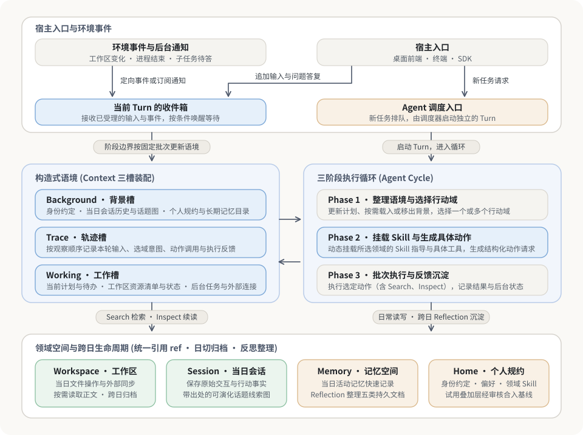
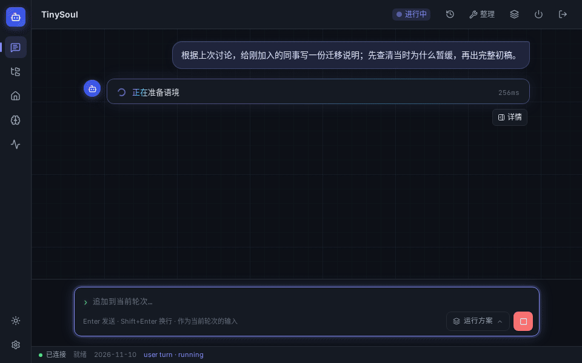
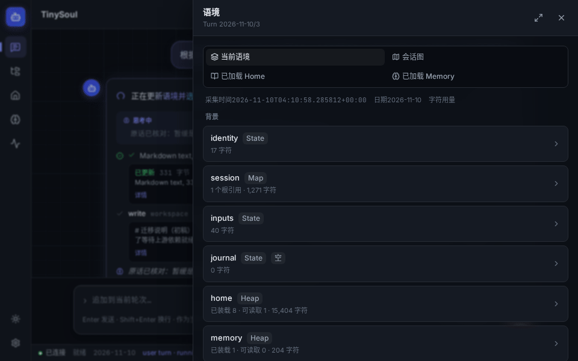
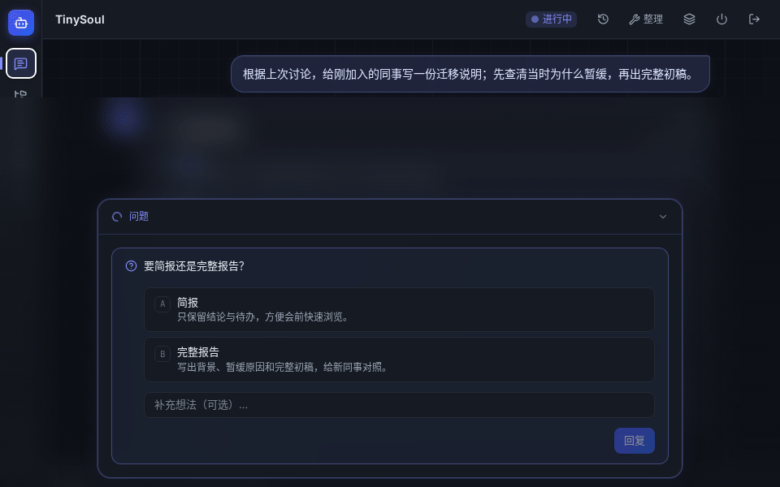
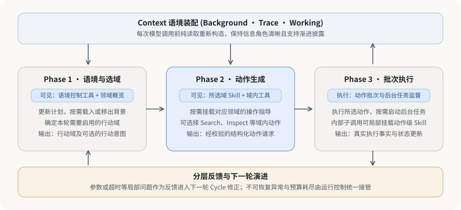
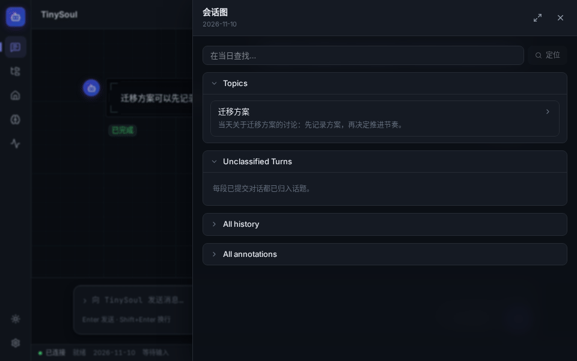
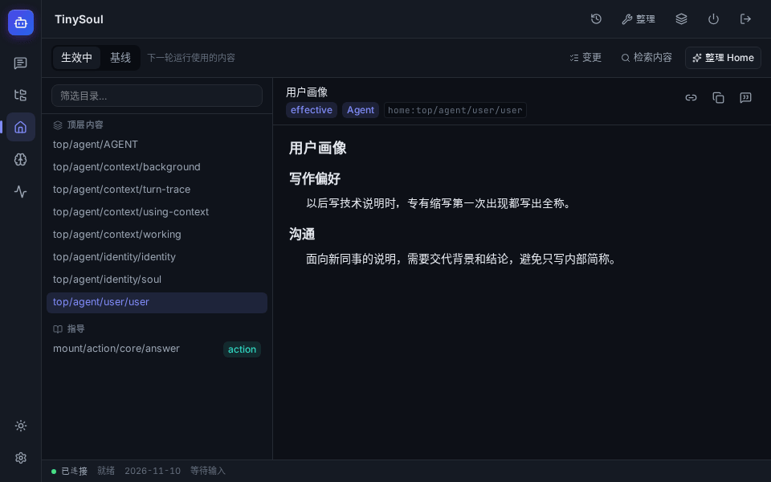

# TinySoul-Agent · A personal agent for ongoing collaboration

[简体中文](../../README.md) · English · **[Getting started](getting-started.en.md)** · [中文启动指南](getting-started.zh-CN.md)

TinySoul is a personal Agent project I explore and refine through vibe coding in my spare time. The idea is simple: after handing over a task, I still want to change direction or add material along the way. When I close my laptop and return later, even days later, I want to understand how the work got here and pick it up again.

That collaboration spans two timescales. Work in progress needs to respond to changing instructions, edited files, and background results. Work across days needs to distinguish what happened from what was tentatively inferred, and turn useful experience into practices worth keeping.

TinySoul uses **Context** to organize what the model sees, and **Actions** and **Workspace** to move work forward. **Session** keeps the interaction history, **Memory** accumulates knowledge with sources, and **Home** holds personal preferences and working guidance. The backend manages their lifecycles; users participate through a desktop frontend, terminal, or Python SDK.

> **Safety notice:** This is a personal project under active development and evaluation. The Agent can execute commands, modify files, and call external services; mistakes may damage data, expose information you give it, or incur API costs. Try it in an isolated virtual machine or dedicated test machine, using disposable or backed-up data. Do not run it directly on a work computer or in production, or give it important credentials. Use a trusted network for remote access and protect the login token.

The [English](getting-started.en.md) and [Chinese](getting-started.zh-CN.md) startup guides cover uv development/standard installations, model configuration, the Rust requirements for the desktop frontend, and remote connections. This page introduces the design.

## How a decision takes shape

At decision step $t$, the Agent observes $o_t$ from environment state $s_t$ and retrieves material $r_t$ from memory $M_t$ for the current goal $g_t$. Relatively stable background $b_t$, the preceding trace within this Turn $h_t$, and new information form context $c_t$. Policy $\pi$ selects an action $a_t$ from that context:

$$
\begin{aligned}
o_t &= O(s_t), & r_t &= R(M_t,g_t,o_t), \\
c_t &= C(g_t,b_t,h_t,o_t,r_t), & a_t &\sim \pi(\cdot\mid c_t).
\end{aligned}
$$

When retrieval is unnecessary, $r_t=\varnothing$. Users, external services, and background tasks can also change the environment between decisions. This framing draws on Hu et al.'s description of observation, action, and memory in [Memory in the Age of AI Agents, Section 2](https://arxiv.org/html/2512.13564v2#S2). TinySoul makes context construction $C$ explicit: the structure, order, and granularity of the same material can influence the next decision.

## Architecture at a glance

| Concern | TinySoul's approach |
| --- | --- |
| Distinguishing background, past activity, and current resources | **Three Context slots:** Background, Trace, and Working, assembled anew before each model call. |
| Selecting tools as capabilities grow | **Three-phase Cycles:** choose domains, load local Skills and generate actions, then execute and return results. |
| Finding material and actually reading it | **Shared references, Search, and Inspect:** find leads and read pages; newly read pages remain protected until a main-loop model call containing them receives a response. |
| Following interleaved topics | **Daily history and a topic graph:** preserve interaction facts and separately maintain interpretations and clarifications with sources. |
| Turning temporary instructions into lasting experience | **Memory, Home, and Reflection:** record or try changes during ordinary work, then review them in separate runs before updating persistent knowledge and guidance. |
| Coordinating execution and modules | **One scheduler and distinct failure layers:** local feedback, module errors, and runtime transfers have separate roles and explicit boundaries. |

The supplied diagrams and demos use Chinese labels. The application interface supports both Chinese and English.

## 1. Model tasks and model chains

Different parts of a long task need different model capabilities. Choosing an action requires understanding goals and tool conditions; writing an answer requires organizing evidence; retrieval may need only vector similarity or relevance scores. TinySoul uses the **task's purpose** to determine context, available tools, and how to interpret the result. Main-loop decisions and content generation can have separate candidate model chains. Auxiliary decisions and embeddings use dedicated model-service configuration.

A model may change midway through a task, while the work already done must remain understandable. TinySoul records **action intent** separately from **execution facts**. The next model can distinguish success, failure, an action not yet executed, and work still supervised in the background, then decide whether to wait, inspect an artifact, or proceed.

Adapters map internal records to OpenAI Chat Completions, OpenAI Responses, Anthropic Messages, and Google GenerateContent. Compatible calls can replay provider-specific reasoning state and use stable-prefix caching where supported. Switching services removes incompatible state while preserving the order of inputs, action requests, and known results.

## 2. Context composition and plugin contributions

A writing preference may remain useful for months; a draft can change from “to write” to “to review” between two calls. **Context helps the model understand the role each piece of information plays in the current task.** An active Turn has three slots:

1. **Background:** identity guidance, completed interactions and topic pointers from the active day, current user inputs, and directories or loaded content from Home and Memory.
2. **Trace:** this Turn's inputs, domain decisions, action calls, and execution feedback, in the order observed by the runtime.
3. **Working:** milestones and todos, Workspace file references and descriptions, and task and connection state.

When a draft is saved, Trace records the call and result, while the Workspace view in Working presents the new file reference. The Agent can add “review draft” to its plan and follow that reference to read it.

Each module maintains its own contributions, which are assembled in order through a pure read before a model call. Workspace supplies references and descriptions; reading actions bring file content into Trace. Execution reports process state and output locations. Adding a capability also means deciding when its state becomes visible and how the model can read further details.

## 3. Search, Inspect, and loading on demand

If the Agent remembers that a design was postponed because of maintenance costs, **Search** can find the discussion and **Inspect** can follow a reference to check the original wording. A known reference can be inspected directly. Session, Memory, Home, and Workspace share reference conventions while retaining ownership of their content.

Search combines three candidate sources (`query`, `backlinks`, `directory`) and three constraint operations (`select`, `rerank`, `filter`) in a bounded pipeline. The model chooses operations and business parameters; configuration binds text matching, vector computation, or model scoring. Results include matching excerpts, coverage, and references to help decide what deserves a closer read.

Inspect presents pages with their actual coverage and a continuation token. Earlier reads can fold into annotated references when context is tight; rereading a mutable file returns its current content. Newly read pages receive protection: folding becomes eligible only after a **main-loop model request containing the full page receives a response**. Auxiliary model calls inside an Action do not release that protection.

## 4. The Agent SDK and environment events

While a model is deciding, the user may add instructions, files may change, and background processes may finish. The terminal, frontend, and host application use the same Agent entry point to submit requests, append information, or answer questions. File watchers provide clues; Workspace synchronizes the actual disk state before notifying the task.

Incoming information enters the current Turn's inbox and joins Context in fixed batches at phase boundaries. Reviewing a decision can therefore show what information was available at that point. Whether an event wakes the Agent depends on what it is waiting for: ordinary file refreshes can be combined, while a completed background task can wake the corresponding wait.

User input also has distinct meanings. When the Agent asks “brief or full report?”, “full report” is a formal reply linked to the question and its options. “Wait for another document” is an additional instruction. Recording them separately preserves what was decided and what remains unanswered.

## 5. The Agent Loop, Skills, and execution feedback

A user request forms a **Turn**, which can contain multiple **Cycles**. Each Cycle has three phases:

1. **Phase 1: organize context and choose action domains.** The model sees Control Tools and domain overviews, updates the plan, loads or evicts background content, and selects domains for this Cycle.
2. **Phase 2: attach Skills and generate actions.** Only Action Tools from selected domains are exposed, along with relevant guidance, to produce concrete ActionCalls.
3. **Phase 3: execute and return feedback.** Actions run, optionally starting Jobs that can span Cycles, and return results and state to the Turn. Jobs are collected and stopped as their owning Turn finishes.

Domains focus the tool selection; Skills explain how to use those tools. More specific guidance accompanies a model call made inside an Action. [ReAct](https://arxiv.org/abs/2210.03629) describes the interaction between reasoning and action; TinySoul further separates domain selection, local guidance, and execution feedback. The extra sequential selection call is a deliberate tradeoff among task quality, latency, and cost for complex work.

The trace distinguishes the chosen direction, proposed actions, and actual results. Correctable argument or protocol problems and individual action failures become local feedback for a later Cycle; a Phase protocol failure ends the current Cycle. Problems that prevent a module from proceeding, such as invalid configuration or an exhausted model chain, pass through its boundary to Runtime. Exhausted execution budgets can suspend the task until the user adds allowance or interrupts it.

## 6. Session history and topic pointers

A day can contain several interleaved topics, and one discussion may belong to more than one. TinySoul saves completed user interactions by Turn and groups the active day's User Turns into a **Session**. Topic pointers make related discussions discoverable without duplicating their bodies.

Session separates original records from later interpretations. Inputs, key actions, and results remain as facts; ordering, replies, and references follow from those records. Topic annotations carry sources. If “postpone migration” was initially understood as “abandon the plan,” a later clarification about an upstream dependency can revise that interpretation and link back to both statements.

A long task crossing midnight finishes its necessary cleanup in its original active day. The system then archives that day's Session, active memory, Workspace, and Trash before starting a new day. Home and persistent Memory continue across days. This rollover does not depend on successful Reflection, so the original facts retain stable sources.

## 7. Memory, Home, and Reflection

“The audience for this briefing is new team members” is a fact with a setting and source, suited to **Memory**. “Spell out abbreviations on first use in future technical notes” is guidance for future work, suited to **Home**.

Both use ordinary recording or trial changes followed by separate reflection. An ordinary Turn can update active memory. When a daily policy or explicit user authorization schedules **Memory Reflection**, it combines source interactions with existing knowledge into five persistent document types: daily, entity, concept, fact, and note. References connect evidence and provide queryable backlinks; migration notes and redirects can preserve the destination of reorganized content.

Everyday Home edits first enter a trial overlay that survives day changes. **Home Reflection** reviews them against the accepted baseline and decides what to merge, rewrite, or discard. Both Reflection modes reuse the same Turn/Cycle/Phase kernel, with their own sources and constrained permissions. They do not write to the user Session, and one-time authorization does not become ongoing permission.

The quality of this consolidation is still being evaluated, particularly the distinction between a temporary delivery requirement and a preference worth keeping.

## 8. MCP, ACP, and capability extensions

An external tool call usually waits for one result. Delegated work may need progress checks across Cycles, responses to permission questions, and a review of its deliverables. TinySoul integrates these through **MCP** (Model Context Protocol) and **ACP** (Agent Client Protocol), with ongoing evaluation of the integrations.

MCP discovers tools and reads their definitions on demand before calling them. Short results enter context; larger material can be saved to Workspace for further reading. ACP delegation carries a goal and selected references, running as a supervised Job across Cycles. The parent checks progress, handles pending questions, and reviews the output. Background work always belongs to its current Turn.

Browser and desktop control remain planned. The intended approach is for the outer Loop to supply a local goal, with an inner process observing and operating the interface, checking results, and returning relevant material and sources. These are not currently provided capabilities.

## 9. A dedicated host and remote use

Core execution, Session, Memory, and Workspace live on a continuously running personal host. The frontend on your computer handles input, inspection, and control. Local and remote connections share the same address-and-stable-token login, with light/dark themes and Chinese/English interface settings.

After the frontend disconnects, a running backend can continue work or wait for a reply. On reconnect, the frontend queries the active task and pending questions, then resumes available observation events. If missed events have left the replay buffer, it fetches current state again.

This continuity requires the **backend process to remain running**. Saved history and files survive later launches; unfinished Turns do not resume after a process crash. See the [startup guide](getting-started.en.md) for installation and connection steps.

## Further reading

- [Architecture and module designs](../design/) · [Agent SDK and lifecycle](../design/agent.md)
- [Endpoint protocol](../endpoint/index.md) · [Frontend design](../../visualization/docs/design/index.md)
- [Test conventions](../../tests/README.md) · [Project collaboration rules](../../AGENTS.md)
